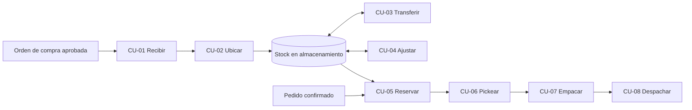

# Casos de uso del MVP

Casos de uso del circuito operativo del MVP 1.0: recibir, ubicar, transferir, ajustar, reservar, pickear, empacar y despachar. Cada caso describe el comportamiento observable desde la API; los estados, permisos y transiciones exactas están en [domain-model.md](../03-architecture/domain-model.md) y las reglas en [business-rules.md](business-rules.md).

Las órdenes de compra (E4) y el inventario físico (E6) se describen con sus máquinas de estado en el modelo de dominio; sus casos de uso se agregan en la etapa en que se implementan.

## Convenciones

| Elemento | Significado |
| - | - |
| `CU-nn` | Caso de uso |
| `FA-nn.x` | Flujo alternativo del caso `CU-nn`: comienza en el paso indicado del flujo principal |
| `FR-nn.x` | Flujo de reversión del caso: deshace, en todo o en parte, el resultado del flujo principal desde su documento (REG-012, DM-15) |
| Endpoints | Relativos a `/api/v1` |
| RECEPCION, PACKING | Ubicaciones de sistema `receiving` y `packing` del depósito |

## Actores

| Actor | Rol habitual | Casos |
| - | - | - |
| Operador de recepción | Operador | CU-01, CU-02 |
| Operador de depósito | Operador | CU-02, CU-03, CU-06, CU-07 |
| Responsable de pedidos | Supervisor | CU-05 |
| Supervisor | Supervisor | CU-04, todas las reversiones, CU-08 |
| Sistema | Proceso interno | Transiciones derivadas: estado de la orden de compra, del pedido y de las tareas |

Los actores son funciones; el permiso que exige cada paso es el que decide, no el rol.

## Comportamiento común

Todo caso de uso que modifica stock cumple estas reglas. No se repiten en cada caso; sus flujos alternativos se citan como `FC-x`.

| ID | Situación | Respuesta |
| - | - | - |
| FC-1 | El usuario no tiene el permiso del paso | 403 |
| FC-2 | El recurso no existe o pertenece a un depósito no asignado al usuario (REG-005) | 404 |
| FC-3 | Falta la cabecera `Idempotency-Key` en un endpoint que la exige | 422 de validación |
| FC-4 | Reintento con la misma clave y el mismo cuerpo | Se devuelve la respuesta almacenada; no se crea otra operación (ADR-007) |
| FC-5 | Misma clave con otro cuerpo | 422 `IDEMPOTENCY_KEY_REUSED` |
| FC-6 | Misma clave mientras la primera petición sigue en curso | 409 `IDEMPOTENCY_REQUEST_IN_PROGRESS` |
| FC-7 | Deadlock o falla de serialización que persiste tras los reintentos internos | 503 `CONCURRENCY_CONFLICT`; el cliente reintenta con la misma clave (ADR-004) |
| FC-8 | Transición no permitida desde el estado actual del documento | 409 `INVALID_STATE_TRANSITION` |
| FC-9 | Una ubicación involucrada no está `active` | 422 `LOCATION_BLOCKED` (INV-009) |

Toda operación exitosa:

1. Se ejecuta en una única transacción (INV-004).
2. Bloquea primero las ubicaciones (`FOR SHARE`) y después las existencias (`FOR UPDATE`), cada grupo en orden ascendente de `id` (ADR-003).
3. Registra una operación con sus movimientos de delta firmado y código de movimiento (INV-002, DM-09).
4. Registra la auditoría en la misma transacción (INV-012).

Toda reversión es por posición y por cantidad (DM-15): se eligen las posiciones del documento y cuánto revertir de cada una, y se puede repetir mientras quede saldo; sin posiciones se revierte el saldo completo. Exige motivo, el permiso `*.reverse` del módulo y la cabecera `Idempotency-Key`, y registra el usuario que la hizo. Revertir más que el saldo de una posición responde 422 `REVERSAL_EXCEEDS_REMAINING`.

## Mapa del circuito

## CU-01. Recibir mercadería

| Campo | Valor |
| - | - |
| Actor | Operador de recepción |
| Objetivo | Ingresar al stock la mercadería que llegó del proveedor, contra una orden de compra |
| Permisos | `receiving.create`, `receiving.confirm`; `receiving.blind` sin orden; `receiving.over_receive` sobre la tolerancia |
| Endpoints | `POST /goods-receipts`, `PATCH /goods-receipts/{id}`, `POST /goods-receipts/{id}/confirm` |
| Movimiento | 101 en RECEPCION |
| Reglas | INV-006, INV-007, REG-004 |
| Etapa | E4 |

**Precondiciones**

- La orden de compra está en `approved`.
- La ubicación RECEPCION del depósito está `active`.

**Flujo principal**

1. El operador crea la recepción indicando la orden de compra. El sistema la crea en `draft` con sus líneas tomadas de la orden.
2. El operador registra, por línea, la cantidad aceptada y, si corresponde, la cantidad rechazada con su motivo. Puede guardar parcialmente; el stock no cambia.
3. El operador confirma la recepción.
4. El sistema bloquea la orden y sus líneas en orden de `id` y valida que lo acumulado recibido no supere lo pedido más la tolerancia (INV-006).
5. El sistema registra una operación `receipt` con un movimiento 101 por línea aceptada sobre RECEPCION.
6. El sistema actualiza `quantity_received` de las líneas de la orden. El estado de la orden no cambia: lo recibido (sin recibir, parcial o total) se calcula de sus líneas.
7. El sistema crea una solicitud de guardado (`PutawayTask`) `pending` por cada línea aceptada, que compromete esa cantidad en RECEPCION (DM-16).
8. La recepción queda en `confirmed`.

**Flujos alternativos**

| ID | Paso | Condición | Resultado |
| - | - | - | - |
| FA-01.1 | 1 | Recepción sin orden de compra | Exige `receiving.blind`; las líneas se cargan a mano. Desde el paso 5 sigue igual, sin actualizar ninguna orden |
| FA-01.2 | 1 | La orden no está en `approved` (por ejemplo, cerrada con entrega final) | 409 `INVALID_STATE_TRANSITION` |
| FA-01.3 | 2 | Cantidad rechazada sin motivo | 422 de validación (REG-004). Lo rechazado nunca ingresa al stock |
| FA-01.4 | 3 | Ninguna línea tiene cantidad | 422 de validación |
| FA-01.5 | 4 | Lo acumulado supera la tolerancia y el usuario no tiene `receiving.over_receive` | 422 `OVER_RECEIPT_NOT_ALLOWED`; la recepción sigue en `draft` |
| FA-01.6 | 4 | Dos recepciones de la misma orden se confirman a la vez | La segunda espera el bloqueo de las líneas y valida contra el acumulado ya actualizado; si excede, FA-01.5 |
| FA-01.7 | 3 | La recepción ya fue confirmada, con otra clave de idempotencia | 409 `OPERATION_ALREADY_CONFIRMED` (INV-007) |
| FA-01.8 | 5 | Todo lo recibido fue rechazado | No se registra operación ni tareas de guardado; la recepción queda `confirmed` con lo rechazado y su motivo, y `quantity_received` de la orden no cambia |
| FA-01.9 | Cualquiera | El operador cancela la recepción en `draft` | Queda `cancelled` sin efecto sobre el stock |

**Flujo de reversión**

| ID | Condición | Resultado |
| - | - | - |
| FR-01.1 | Una o más posiciones de la recepción, por una cantidad libre en RECEPCION | `POST /goods-receipts/{id}/reverse` con posiciones y cantidades: operación `reversal` con 102. Ejemplo: de 101 × 50 se revierten 10; la posición queda con un neto de 40 y la orden de compra con 40 recibidas. La recepción sigue `confirmed` y muestra por posición aceptado, revertido y neto |
| FR-01.2 | La cantidad está comprometida por una solicitud de guardado pendiente | 409 `DEPENDENT_DOCUMENTS_NOT_REVERSED`: primero se revierte esa cantidad de la solicitud (FR-02.1) |
| FR-01.3 | La cantidad ya se guardó en estanterías | 409 `DEPENDENT_DOCUMENTS_NOT_REVERSED`: primero se revierte el guardado (FR-02.2) |
| FR-01.4 | Se pide revertir más que el saldo de la posición | 422 `REVERSAL_EXCEEDS_REMAINING` |

**Postcondiciones**

- El stock de RECEPCION aumentó en lo aceptado, con un movimiento 101 por línea.
- La orden de compra refleja lo recibido.
- Existe una solicitud de guardado por línea aceptada.

## CU-02. Ubicar mercadería (putaway)

| Campo | Valor |
| - | - |
| Actor | Acomodador (operador de recepción o de depósito); supervisor |
| Objetivo | Llevar la mercadería recibida desde RECEPCION a sus ubicaciones de almacenamiento |
| Permisos | `putaway.execute` para completar; `putaway.reverse` para revertir, en los roles Operador y Supervisor |
| Endpoints | `GET /putaway-tasks`, `POST /putaway-tasks/{id}/complete`, `POST /putaway-tasks/{id}/reverse` |
| Movimiento | 911 salida de RECEPCION y entrada en cada destino; 912 en la reversión de lo guardado |
| Reglas | INV-001, INV-004, INV-005, INV-009, REG-010, DM-16 |
| Etapa | E4 |

**Precondiciones**

- Existe una solicitud de guardado `pending`, que compromete su cantidad en RECEPCION.

**Flujo principal**

1. El acomodador consulta las solicitudes de guardado pendientes del depósito y elige una.
2. Lleva la mercadería y escanea cada ubicación de destino con la cantidad que dejó en ella. Puede repartirla en varias ubicaciones.
3. Completa la solicitud.
4. El sistema valida que la suma de los destinos sea igual a lo que queda por guardar (cantidad solicitada menos lo revertido), que cada destino esté `active` y que no supere su capacidad máxima (REG-010).
5. El sistema registra una operación `putaway` con 911, una salida de RECEPCION y una entrada por destino, y consume la reserva de la solicitud.
6. La solicitud queda en `completed`.

**Flujos alternativos**

| ID | Paso | Condición | Resultado |
| - | - | - | - |
| FA-02.1 | 4 | La suma de los destinos no coincide con lo que queda por guardar | 422 de validación |
| FA-02.2 | 4 | Un destino supera su capacidad máxima | 422 `LOCATION_CAPACITY_EXCEEDED`; el acomodador elige otro destino |
| FA-02.3 | 4 | Un destino está bloqueado o en conteo | FC-9 |
| FA-02.4 | 3 | Dos acomodadores completan la misma solicitud | El primero la completa; el segundo recibe 409 `OPERATION_ALREADY_CONFIRMED` o la respuesta almacenada si es un reintento (FC-4) |
| FA-02.5 | 2 | El acomodador no puede guardar parte de la mercadería (por ejemplo, 10 de 50 están rotas) | Antes de completar, revierte esa cantidad de la solicitud con su motivo (FR-02.1) y completa por el resto |
| FA-02.6 | 1 | El supervisor decide guardar menos de lo solicitado | Revierte la diferencia de la solicitud con su motivo (FR-02.1); la solicitud sigue pendiente por el resto |

**Flujo de reversión**

| ID | Condición | Resultado |
| - | - | - |
| FR-02.1 | Solicitud `pending`: el acomodador o el supervisor revierte una cantidad con motivo | `POST /putaway-tasks/{id}/reverse`: la solicitud baja lo que queda por guardar y la reserva se reemplaza por una por el saldo. No hay movimiento de stock, porque la mercadería no salió de RECEPCION. Queda registrado quién la revirtió, cuándo y por qué. Si se revierte todo, la solicitud pasa a `completed` con guardado 0 |
| FR-02.2 | Solicitud `completed`: se devuelve al origen parte de lo guardado, con lo revertido libre en cada destino y el origen `active` | `POST /putaway-tasks/{id}/reverse` con destinos y cantidades: operación `reversal` con 912 de los destinos a RECEPCION. La mercadería devuelta queda libre en RECEPCION. La solicitud sigue `completed` y muestra guardado, revertido y neto |
| FR-02.3 | Lo guardado ya no está libre en algún destino (reservado o retirado) | 422 `INSUFFICIENT_STOCK` |

**Flujo relacionado (separado)**

Lo que se revirtió queda libre en RECEPCION. El supervisor ve en la solicitud la cantidad revertida, quién lo hizo y el motivo, y decide por su cuenta: por ejemplo, ante el motivo "roto", registra una baja por daño con 551 en RECEPCION (CU-04). Son dos operaciones distintas, con usuarios distintos.

Ejemplo completo:

| Paso | Quién | Acción | Resultado |
| - | - | - | - |
| 1 | Sistema | Confirma la recepción de 50 | Solicitud de guardado por 50, que compromete las 50 de RECEPCION |
| 2 | Acomodador | Revierte 10 de la solicitud, motivo "roto" | Solicitud por 40; las 10 quedan libres en RECEPCION |
| 3 | Acomodador | Guarda 40 en A01-01-01 y completa | 911 × 40: RECEPCION 10, A01-01-01 40 |
| 4 | Supervisor | Lee el motivo y da de baja las 10 por rotura | 551 × 10: RECEPCION 0 |

**Postcondiciones**

- La mercadería guardada está en ubicaciones de almacenamiento y disponible para reservar.
- Lo revertido de la solicitud quedó libre en RECEPCION, con su motivo y su usuario.

## CU-03. Transferir stock entre ubicaciones

| Campo | Valor |
| - | - |
| Actor | Operador de depósito |
| Objetivo | Mover cantidades de uno o más productos entre ubicaciones del mismo depósito, en una transferencia con una o más posiciones |
| Permisos | `inventory.transfer`; `inventory.reverse` para revertir |
| Endpoints | `POST /inventory/transfers`, `POST /inventory/operations/{id}/reverse` |
| Movimiento | 931 por posición: salida en origen y entrada en destino, con el mismo número de posición |
| Reglas | INV-001, INV-004, INV-005, INV-009, REG-010 |
| Etapa | E3 |

**Precondiciones**

- El producto tiene stock libre en la ubicación de origen.
- Origen y destino pertenecen al mismo depósito.

**Flujo principal**

1. El operador carga una o más posiciones (hasta 100): por cada una, la ubicación de origen, el producto, la cantidad y la ubicación de destino.
2. La interfaz muestra un resumen; el operador confirma.
3. El sistema bloquea las ubicaciones y las existencias de todas las posiciones en orden de `id` y valida que las ubicaciones estén `active`.
4. El sistema valida, por posición, que el libre del origen (físico menos reservado menos bloqueado) alcance la cantidad y que el destino no supere su capacidad.
5. El sistema registra una operación `transfer` con dos movimientos 931 por posición, salida en origen y entrada en destino con el mismo número de posición, en la misma transacción. Si falla una posición, no se registra ninguna.

**Flujos alternativos**

| ID | Paso | Condición | Resultado |
| - | - | - | - |
| FA-03.1 | 1 | Origen igual a destino | 422 `SAME_SOURCE_AND_DESTINATION` |
| FA-03.2 | 4 | El stock libre no alcanza | 422 `INSUFFICIENT_STOCK` |
| FA-03.3 | 4 | Hay físico suficiente pero está reservado o bloqueado | 422 `RESERVED_STOCK_NOT_AVAILABLE` (INV-005) |
| FA-03.4 | 4 | Dos operadores transfieren a la vez el mismo stock y entre ambos superan el libre | La segunda transacción espera el bloqueo, lee el saldo actualizado y recibe FA-03.2. Nunca queda stock negativo |
| FA-03.5 | 3 | Transferencias cruzadas simultáneas A hacia B y B hacia A | El orden de bloqueo por `id` evita el deadlock; si igualmente ocurre, se reintenta (FC-7) |
| FA-03.6 | 3 | Origen o destino bloqueado o en conteo | FC-9 |
| FA-03.7 | 4 | El destino supera su capacidad | 422 `LOCATION_CAPACITY_EXCEEDED` |
| FA-03.8 | 2 | Doble clic o reintento de red | La interfaz reutiliza la clave generada al abrir el formulario (FC-4): una sola transferencia |
| FA-03.9 | 1 | El destino es una ubicación de sistema (RECEPCION, PACKING o DESPACHO) | 422 `SYSTEM_LOCATION_NOT_ALLOWED` (REG-014) |
| FA-03.10 | 1 | El origen es RECEPCION | Se permite sobre lo que esté libre. Lo comprometido por una solicitud de guardado pendiente responde 422 `RESERVED_STOCK_NOT_AVAILABLE`: primero se revierte esa cantidad de la solicitud (FR-02.1, DM-14) |
| FA-03.11 | 1 | Dos posiciones mueven el mismo producto en la misma ubicación (por ejemplo, de A a B y de B a C) | 422 de validación sobre la segunda posición: cada existencia se mueve en una sola posición por operación. Se registran como dos transferencias |

**Flujo de reversión**

| ID | Condición | Resultado |
| - | - | - |
| FR-03.1 | La cantidad a revertir sigue libre en el destino y ambas ubicaciones están `active` | `POST /inventory/operations/{id}/reverse` con la posición y la cantidad: operación `reversal` con 932, del destino al origen. Se puede revertir una parte (por ejemplo 10 de 50) y más adelante el resto |
| FR-03.2 | La cantidad ya no está libre en el destino | 422 `INSUFFICIENT_STOCK` |
| FR-03.3 | Se pide revertir más que el saldo de la transferencia | 422 `REVERSAL_EXCEEDS_REMAINING` |

**Postcondiciones**

- La suma del producto en el depósito no cambió.
- Origen y destino reflejan la transferencia, o ninguno de los dos si falló.

## CU-04. Ajustar stock

| Campo | Valor |
| - | - |
| Actor | Supervisor u operador autorizado |
| Objetivo | Corregir el stock de una ubicación por daño, pérdida, hallazgo, corrección o carga inicial |
| Permisos | `inventory.adjust`; `inventory.adjust.approve` para salidas sobre el umbral; `inventory.reverse` para revertir |
| Endpoints | `POST /inventory/adjustments`, `POST /inventory/operations/{id}/reverse` |
| Movimiento | 551 `damage`, 711 `loss`, 712 `found`, 711 o 712 `correction`, 561 `initial_load` |
| Reglas | INV-001, INV-005, INV-008, INV-009 |
| Etapa | E3 |

**Precondiciones**

- La ubicación está `active`.

**Flujo principal**

1. El usuario indica ubicación, producto, cantidad con signo, motivo de la lista cerrada y observación.
2. La interfaz muestra el stock actual y el resultante; el usuario confirma.
3. El sistema bloquea la ubicación y la existencia, y valida el motivo y el signo: `damage` y `loss` solo restan, `found` e `initial_load` solo suman, `correction` admite ambos.
4. En un ajuste negativo, el sistema valida que la cantidad no supere el stock libre y, si supera el umbral configurado, que el usuario tenga `inventory.adjust.approve`.
5. El sistema registra una operación `adjustment_in` o `adjustment_out` con el código de movimiento que corresponde al motivo.

**Flujos alternativos**

| ID | Paso | Condición | Resultado |
| - | - | - | - |
| FA-04.1 | 1 | Sin motivo o con un motivo fuera de la lista | 422 de validación (INV-008) |
| FA-04.2 | 3 | El signo no corresponde al motivo | 422 de validación |
| FA-04.3 | 4 | La salida deja el físico por debajo de lo reservado más lo bloqueado | 422 `RESERVED_STOCK_NOT_AVAILABLE`; primero se liberan reservas o bloqueos |
| FA-04.4 | 4 | La salida supera el físico | 422 `INSUFFICIENT_STOCK` |
| FA-04.5 | 4 | La salida supera el umbral y el usuario no tiene `inventory.adjust.approve` | 403; la diferencia se escala a un supervisor |
| FA-04.7 | 3 | Ajuste positivo en una ubicación de sistema (RECEPCION, PACKING o DESPACHO) | 422 `SYSTEM_LOCATION_NOT_ALLOWED` (REG-014). Un sobrante en RECEPCION se registra con una recepción sin orden (FA-01.1) |
| FA-04.6 | 3 | Ubicación bloqueada o en conteo | FC-9. Las diferencias de una ubicación en conteo se resuelven aprobando el inventario físico |

**Flujo de reversión**

| ID | Condición | Resultado |
| - | - | - |
| FR-04.1 | Ajuste confirmado y la reversión no deja stock negativo | `POST /inventory/operations/{id}/reverse` con líneas y cantidades: operación `reversal` con el código de reversión de cada línea (552, 562, 711 o 712), en todo o en parte |
| FR-04.2 | Revertir un ajuste positivo dejaría stock negativo o por debajo de lo comprometido | 422 `INSUFFICIENT_STOCK` |
| FR-04.3 | Se pide revertir más que el saldo de la línea | 422 `REVERSAL_EXCEEDS_REMAINING` |

**Postcondiciones**

- El stock refleja el ajuste y el movimiento conserva motivo, usuario y observación.

## CU-05. Reservar stock para un pedido

| Campo | Valor |
| - | - |
| Actor | Responsable de pedidos |
| Objetivo | Comprometer stock disponible para un pedido confirmado, de modo que nadie más pueda usarlo |
| Permisos | `orders.reserve` |
| Endpoints | `POST /orders/{id}/reserve`, `POST /orders/{id}/release` |
| Movimiento | Ninguno: la reserva cambia `quantity_reserved`, no el físico |
| Reglas | INV-005 |
| Etapa | E5 |

**Precondiciones**

- El pedido está en `confirmed`.

**Flujo principal**

1. El usuario solicita la reserva del pedido.
2. El sistema busca, por línea, existencias del producto con stock libre en ubicaciones `active` de zonas `storage` y `picking`, en orden FIFO por `last_movement_at`.
3. El sistema bloquea esas existencias en orden de `id` y vuelve a leer el libre dentro de la transacción.
4. El sistema crea una reserva por existencia usada hasta cubrir cada línea y actualiza `quantity_reserved` de las existencias y de las líneas del pedido.
5. El pedido sigue en `confirmed` y muestra por línea lo reservado respecto de lo pedido.

**Flujos alternativos**

| ID | Paso | Condición | Resultado |
| - | - | - | - |
| FA-05.1 | 2 | El libre no cubre todo y el pedido tiene `allow_partial = false` | 422 `INSUFFICIENT_STOCK`; no se reserva nada |
| FA-05.2 | 2 | El libre no cubre todo y el pedido tiene `allow_partial = true` | Se reserva lo disponible; el pedido sigue en `confirmed` con reserva parcial. Una reserva posterior completa el resto |
| FA-05.3 | 2 | No hay stock libre de ninguna línea | 422 `INSUFFICIENT_STOCK`; el estado no cambia |
| FA-05.4 | 3 | Dos pedidos reservan a la vez el mismo stock | El segundo espera el bloqueo y reserva solo lo que dejó libre el primero. La suma de reservas nunca supera el físico menos lo bloqueado (INV-005) |
| FA-05.5 | Posterior | El usuario libera las reservas de un pedido sin picking | `POST /orders/{id}/release`: libera todas las reservas activas y el pedido vuelve a `confirmed` (DM-12) |
| FA-05.6 | Posterior | El pedido se cancela | Libera todas las reservas activas (REG-009 impide cancelar desde `packed`) |

**Postcondiciones**

- El stock reservado no puede retirarse por transferencia, ajuste ni otra reserva.
- Cada reserva apunta a una existencia y a una línea de pedido.

## CU-06. Pickear un pedido

| Campo | Valor |
| - | - |
| Actor | Operador de depósito |
| Objetivo | Retirar de sus ubicaciones la mercadería reservada y llevarla a PACKING |
| Permisos | `picking.manage` para generar y asignar; `picking.execute` para tomar y resolver líneas; `picking.reverse` para revertir |
| Endpoints | `POST /orders/{id}/picking-tasks`, `GET /picking-tasks/next`, `POST /picking-tasks/{id}/start`, `POST /picking-tasks/{id}/lines/{lineId}/pick`, `POST /picking-tasks/{id}/lines/{lineId}/short` |
| Movimiento | 921 salida de la ubicación de almacenamiento y entrada en PACKING |
| Reglas | INV-005, INV-009, REG-007, REG-008 |
| Etapa | E5 |

**Precondiciones**

- El pedido está en `confirmed`, con algo reservado y sin otra tarea de picking abierta.

**Flujo principal**

1. El responsable genera la tarea de picking. El sistema crea una línea por reserva, ordenadas por código de ubicación, y el pedido pasa a `picking`.
2. El operador pide la siguiente tarea. El sistema le asigna la más antigua según la prioridad del pedido, con `FOR UPDATE SKIP LOCKED`.
3. El operador inicia la tarea.
4. Por cada línea, el operador va a la ubicación, escanea la ubicación y el producto y confirma la cantidad.
5. El sistema valida el escaneo y registra una operación `pick` con 921 de la ubicación a PACKING. Consume la reserva de almacenamiento y crea una reserva sobre PACKING para la misma línea de pedido.
6. Al confirmar la última línea, la tarea queda en `completed` y el pedido en `picked`.

**Flujos alternativos**

| ID | Paso | Condición | Resultado |
| - | - | - | - |
| FA-06.1 | 2 | Dos operadores piden la siguiente tarea a la vez | `SKIP LOCKED` asigna tareas distintas; ninguno espera al otro |
| FA-06.2 | 3 | El operador ya tiene otra tarea en curso | 409 `PICKING_TASK_IN_PROGRESS` (REG-007) |
| FA-06.3 | 4 | El escaneo no coincide con la ubicación o el producto esperados | 422 `SCAN_MISMATCH` (REG-008); la línea sigue `pending` |
| FA-06.4 | 4 | El operador encuentra menos de lo esperado | Resuelve la línea como faltante con lo encontrado, posiblemente cero. Si es mayor que cero se registra el pick por esa cantidad; el resto de la reserva se libera, se incrementa `quantity_short` y la ubicación se marca para conteo cíclico |
| FA-06.5 | 6 | Alguna línea terminó con faltante | La tarea queda en `completed` y muestra por línea a pickear, pickeado y faltante; el pedido pasa a `picked` con lo pickeado |
| FA-06.6 | 6 | Todas las líneas terminaron con faltante total | El pedido pasa a `picked` con pickeado 0 y el faltante a la vista. El sistema no lo cancela: el responsable decide cancelarlo con motivo (DM-03) |
| FA-06.7 | 4 | La ubicación fue bloqueada después de generar la tarea | FC-9; el supervisor desbloquea o resuelve la línea como faltante |
| FA-06.8 | 3 | El supervisor reasigna una tarea en curso | Vuelve a `assigned` con otro operador; conserva las líneas resueltas |
| FA-06.9 | Cualquiera | El pedido se cancela con la tarea activa | La tarea pasa a `cancelled`; lo ya pickeado queda en PACKING con una solicitud de guardado de retorno |

**Flujo de reversión**

| ID | Condición | Resultado |
| - | - | - |
| FR-06.1 | Línea confirmada con algo pickeado, pedido sin empacar y ubicación de origen `active` | `POST /picking-tasks/{id}/lines/{lineId}/reverse` con la cantidad: operación `reversal` con 922 de PACKING al origen por esa cantidad, reserva recreada en origen y una línea pendiente por lo revertido en una tarea nueva del pedido. Por ejemplo, de 20 pickeadas se revierten 5 y quedan 15 en PACKING. La tarea original queda `completed` y muestra pickeado 20, revertido 5, neto 15; el pedido vuelve a `picking`. Lo faltante no se restituye |
| FR-06.2 | El pedido ya está empacado | 409 `DEPENDENT_DOCUMENTS_NOT_REVERSED`: primero se desempaca (FR-07.1) |
| FR-06.3 | Se pide revertir más que el saldo de la línea | 422 `REVERSAL_EXCEEDS_REMAINING` |

**Postcondiciones**

- Lo pickeado está en PACKING, reservado para el pedido.
- Las ubicaciones de origen disminuyeron en lo pickeado; los faltantes quedaron registrados.

## CU-07. Empacar un pedido

| Campo | Valor |
| - | - |
| Actor | Operador de depósito |
| Objetivo | Embalar lo pickeado en bultos y verificar que coincide con el pedido |
| Permisos | `packing.execute`; `packing.reverse` para desempacar; `inventory.adjust` para la baja por daño |
| Endpoints | `POST /orders/{id}/packages`, `POST /orders/{id}/pack`, `POST /orders/{id}/unpack`, `POST /orders/{id}/items/{itemId}/packing-damage` |
| Movimiento | Ninguno, salvo la baja por daño: 551 en PACKING |
| Reglas | INV-011 |
| Etapa | E5 |

**Precondiciones**

- El pedido está en `picked`.

**Flujo principal**

1. El operador registra los bultos y, por cada uno, los productos y cantidades que contiene.
2. El operador cierra el packing.
3. El sistema valida que, por línea, lo empaquetado sea igual a lo pickeado.
4. El pedido queda en `packed`.

**Flujos alternativos**

| ID | Paso | Condición | Resultado |
| - | - | - | - |
| FA-07.1 | 3 | Lo empaquetado no coincide con lo pickeado | 422 de validación con las líneas que difieren; el pedido sigue en `picked` |
| FA-07.2 | 1 | Se detecta mercadería dañada al embalar | `POST /orders/{id}/items/{itemId}/packing-damage`: baja con 551 en PACKING que consume la reserva de la línea, y la cantidad pasa a faltante (DM-13). Sobre el umbral de INV-008 exige `inventory.adjust.approve` (403 sin él). El pedido no cambia de estado aunque no quede nada pickeado; si corresponde, el responsable lo cancela con motivo |
| FA-07.3 | 1 | El pedido ya está en `packed` cuando se detecta el daño | Se desempaca (FR-07.1) y sigue FA-07.2 |

**Flujo de reversión**

| ID | Condición | Resultado |
| - | - | - |
| FR-07.1 | Pedido `packed` sin despacho vigente | `POST /orders/{id}/unpack`: el pedido vuelve a `picked` y los bultos son editables. No mueve stock |
| FR-07.2 | Baja por daño con el pedido en `picked` | `POST /inventory/operations/{id}/reverse`, en todo o en parte: 552 en PACKING, reserva recreada para la línea por lo revertido y esa cantidad vuelve de `quantity_short` a `quantity_picked` |
| FR-07.3 | Baja por daño con el pedido `cancelled` | La reversión deja la mercadería libre en PACKING y crea una solicitud de guardado de retorno |
| FR-07.4 | Baja por daño con el pedido en `packed` o `dispatched` | 409 `DEPENDENT_DOCUMENTS_NOT_REVERSED`: primero se revierte el despacho y se desempaca |

**Postcondiciones**

- El pedido está listo para despachar.

## CU-08. Despachar un pedido

| Campo | Valor |
| - | - |
| Actor | Supervisor u operador autorizado |
| Objetivo | Registrar la salida física de la mercadería del depósito |
| Permisos | `dispatch.execute`; `dispatch.reverse` para revertir |
| Endpoints | `POST /orders/{id}/dispatch`, `POST /dispatches/{id}/reverse` |
| Movimiento | 601 en PACKING |
| Reglas | INV-007, INV-011 |
| Etapa | E5 |

**Precondiciones**

- El pedido está en `packed`.

**Flujo principal**

1. El usuario confirma el despacho del pedido, con datos de transporte opcionales.
2. El sistema bloquea el pedido y las existencias de PACKING reservadas para él.
3. El sistema crea el despacho (`DS`) y una operación `dispatch` con un movimiento 601 por existencia de PACKING, que consume las reservas.
4. El pedido queda en `dispatched` y el despacho en `confirmed`.

**Flujos alternativos**

| ID | Paso | Condición | Resultado |
| - | - | - | - |
| FA-08.1 | 2 | El pedido no está en `packed` | 409 `ORDER_NOT_READY_FOR_DISPATCH` (INV-011) |
| FA-08.2 | 1 | Reintento con la misma clave | FC-4: un solo despacho |
| FA-08.3 | 1 | Segundo despacho del mismo pedido con otra clave | 409 `OPERATION_ALREADY_CONFIRMED`; el índice único de despacho vigente por pedido lo impide aunque falle la aplicación |

**Flujo de reversión**

| ID | Condición | Resultado |
| - | - | - |
| FR-08.1 | Despacho `confirmed`; parte de la mercadería no salió o volvió | `POST /dispatches/{id}/reverse` con productos, cantidades y motivo: operación `reversal` con 602 en PACKING. Lo revertido queda libre en PACKING con una solicitud de guardado de retorno. Ejemplo: de 50 despachadas vuelven 10; el despacho muestra despachado 50, revertido 10, neto 40 (DM-17) |
| FR-08.2 | Se revierte todo lo despachado | Ni el despacho ni el pedido cambian de estado: muestran despachado 10, revertido 10, neto 0. Si el cliente igual quiere la mercadería, se carga un pedido nuevo |
| FR-08.3 | Se pide revertir más que el saldo de un producto | 422 `REVERSAL_EXCEEDS_REMAINING` |

**Postcondiciones**

- El stock de PACKING disminuyó en lo despachado; no quedan reservas activas del pedido.
- Toda reversión posterior queda en el historial junto al despacho original, con su usuario y su motivo.
- El historial muestra la cadena completa: recepción, guardado, reserva, pick, empaque y despacho.

## Trazabilidad

| Caso | Invariantes | Reglas | Movimientos | Etapa |
| - | - | - | - | - |
| CU-01 Recibir | INV-002, INV-006, INV-007, INV-012 | REG-004, REG-012 | 101, 102 | E4 |
| CU-02 Ubicar | INV-001, INV-004, INV-005, INV-009 | REG-010, REG-012 | 911, 912 | E4 |
| CU-03 Transferir | INV-001, INV-004, INV-005, INV-009 | REG-010, REG-012, REG-014 | 931, 932 | E3 |
| CU-04 Ajustar | INV-001, INV-005, INV-008, INV-009 | REG-012, REG-014 | 551, 561, 711, 712 y sus reversiones | E3 |
| CU-05 Reservar | INV-005 | | | E5 |
| CU-06 Pickear | INV-005, INV-009 | REG-007, REG-008, REG-012 | 921, 922 | E5 |
| CU-07 Empacar | INV-005, INV-008, INV-011 | REG-009, REG-012 | 551, 552 | E5 |
| CU-08 Despachar | INV-007, INV-011 | REG-012 | 601, 602 | E5 |

