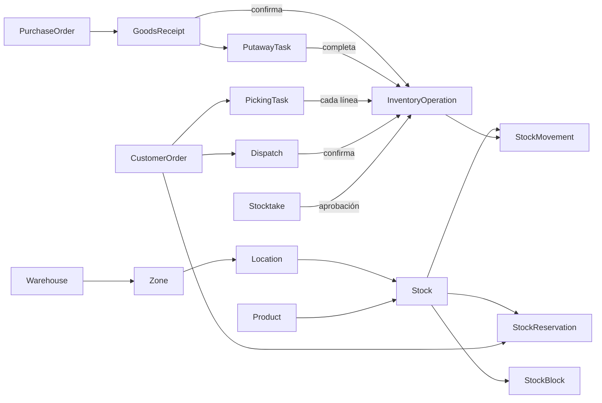
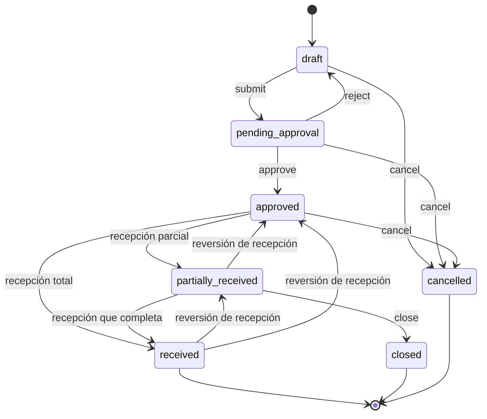
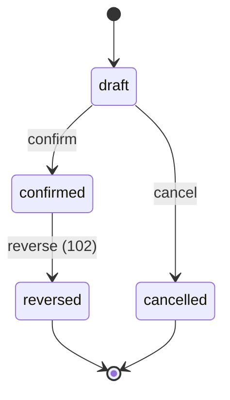
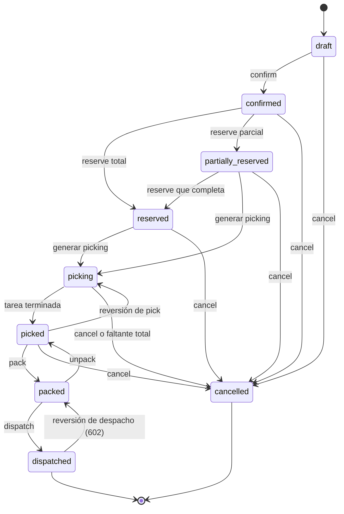
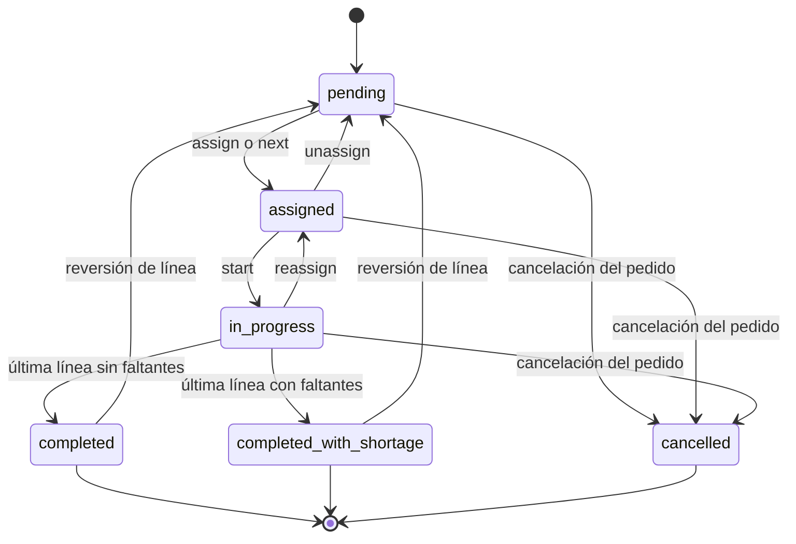
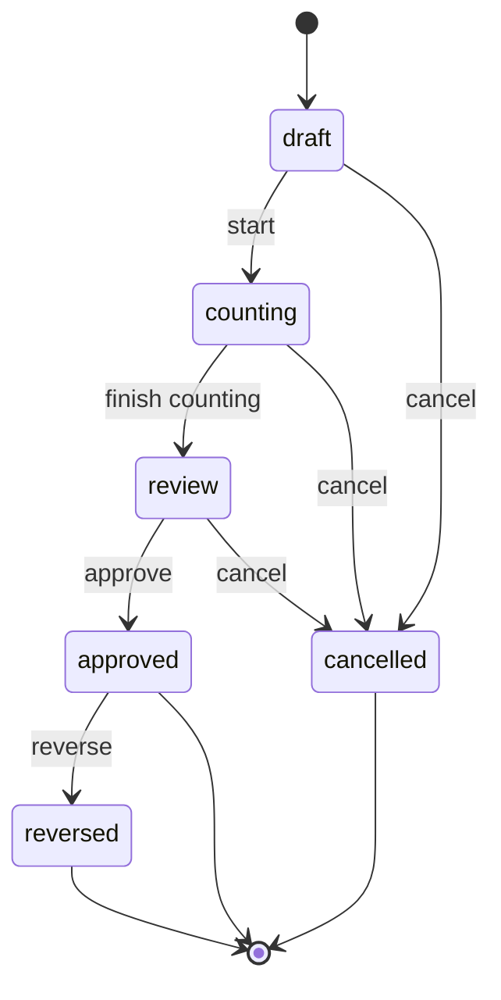

# Modelo de dominio

Entidades por módulo, relaciones principales y máquinas de estado de los documentos. Los nombres siguen el [glosario](../01-business/glossary.md); las reglas citadas están en [business-rules.md](../02-analysis/business-rules.md); el esquema físico está en [database-design.md](database-design.md).

## Convenciones

| Concepto | Criterio |
| - | - |
| Transición | Cambio de estado de un documento ejecutado por una Action. Toda transición no listada en la tabla de su máquina es inválida y responde 409 `INVALID_STATE_TRANSITION` |
| Permiso | Permiso de `spatie/laravel-permission` con nomenclatura `modulo.accion`, verificado por la Policy junto con la pertenencia del documento a un depósito asignado al usuario (REG-005, [ADR-009](adr/009-spa-authentication-authorization.md)) |
| Sistema | Transición que no se invoca directamente: es efecto de otra transición y ocurre en la misma transacción, con el permiso de la transición que la provoca |
| Bloqueo de cabecera | Toda transición bloquea la fila del documento con `SELECT ... FOR UPDATE` y valida el estado después de obtener el bloqueo. Esto serializa transiciones concurrentes sobre el mismo documento |
| Estado final | Estado sin transiciones de salida. Un documento en estado final no se edita |
| Auditoría | Toda transición escribe un registro en `audit_logs` dentro de la misma transacción (INV-012) |
| Reversión | Transición que anula el efecto sobre el stock de un documento confirmado mediante una operación `reversal` con los códigos de reversión (DM-04). Exige motivo y un permiso `*.reverse` propio |
| Clave de ayuda | Cada estado, código de movimiento, tipo de tarea y código de error tiene una clave estable que la interfaz usa para enlazar a su explicación en la wiki (DM-11) |

## Módulos y entidades

Organización según [ADR-001](adr/001-modular-monolith.md). Solo `Inventory` escribe en `stocks`, `stock_movements`, `stock_reservations` y `stock_blocks`; los demás módulos invocan sus Actions.

| Módulo | Entidad | Tabla | Rol |
| - | - | - | - |
| Identity | `User` | `users` | Usuario; se desactiva, nunca se borra |
| | `Role`, `Permission` | tablas de `spatie/laravel-permission` | Roles y permisos |
| Warehouse | `Warehouse` | `warehouses` | Raíz del alcance de seguridad |
| | `Zone` | `zones` | Agrupación funcional de ubicaciones |
| | `Location` | `locations` | Lugar físico con estado propio (ver máquina de estados) |
| | asignación usuario depósito | `user_warehouse` | Alcance de seguridad (REG-005) |
| Catalog | `Category` | `categories` | Jerarquía de productos |
| | `UnitOfMeasure` | `units_of_measure` | Unidad base ([ADR-005](adr/005-integer-quantities.md)) |
| | `Product` | `products` | Artículo maestro |
| | `Supplier` | `suppliers`, `product_supplier` | Proveedor y su código de producto |
| | `Customer` | `customers` | Destinatario de pedidos |
| Inventory | `Stock` | `stocks` | Proyección por producto, ubicación y lote |
| | `InventoryOperation` | `inventory_operations` | Hecho de negocio confirmado, inmutable |
| | `StockMovement` | `stock_movements` | Línea de operación con delta firmado, inmutable |
| | `StockReservation` | `stock_reservations` | Compromiso de stock para una línea de pedido |
| | `StockBlock` | `stock_blocks` | Inmovilización de una cantidad sin moverla |
| | `MovementType` | `movement_types` | Catálogo de códigos de movimiento con su reversión (DM-09) |
| | `IdempotencyKey` | `idempotency_keys` | Registro de peticiones idempotentes ([ADR-007](adr/007-idempotency.md)) |
| Procurement | `PurchaseOrder` | `purchase_orders`, `purchase_order_items` | Orden de compra y sus líneas |
| Receiving | `GoodsReceipt` | `goods_receipts`, `goods_receipt_items` | Recepción y sus líneas |
| | `PutawayTask` | `putaway_tasks` | Traslado pendiente a almacenamiento |
| Fulfillment | `CustomerOrder` | `customer_orders`, `customer_order_items` | Pedido y sus líneas |
| | `PickingTask` | `picking_tasks`, `picking_task_lines` | Tarea de picking y sus líneas |
| | `Package` | `packages`, `package_items` | Bulto y su contenido |
| | `Dispatch` | `dispatches` | Salida de mercadería de un pedido; documento propio y reversible (DM-10) |
| Stocktaking | `Stocktake` | `stocktakes`, `stocktake_locations`, `stocktake_items` | Inventario físico, alcance y conteos |
| Audit | `AuditLog` | `audit_logs` | Registro inmutable de auditoría |

## Relaciones principales

| Relación | Cardinalidad | Nota |
| - | - | - |
| Documento a operación | Un documento origina como máximo una operación de inventario por instancia (recepción, tarea de putaway, línea de picking, despacho, inventario físico), más su reversión | Garantizado en base de datos por la unicidad de la referencia de la operación (ver [database-design.md](database-design.md#e3-núcleo-transaccional-de-inventario)) |
| Operación a movimientos | Una operación tiene uno o más movimientos, cada uno con su código (DM-09) | Una transferencia tiene dos (931 salida y entrada); un despacho, uno por fila de stock de PACKING (601) |
| Operación a reversión | Una operación se revierte como máximo una vez, con una operación `reversal` vinculada por `reverses_operation_id` | Garantizado en base de datos por `inventory_operations_reverses_operation_id_unique` |
| Línea de pedido a reservas | Una línea de pedido tiene cero o más reservas | Una por fila de stock asignada, más una sobre PACKING por cada pick confirmado |
| Reserva a línea de picking | Una reserva de almacenamiento genera exactamente una línea de picking | |

## Máquinas de estado de los documentos

### PurchaseOrder

| Estado | Significado | Final |
| - | - | - |
| `draft` | En edición; único estado editable (REG-002) | No |
| `pending_approval` | Enviada a aprobación | No |
| `approved` | Aprobada, sin recepciones confirmadas | No |
| `partially_received` | Al menos una recepción confirmada y alguna línea con saldo pendiente | No |
| `received` | Todas las líneas recibidas en su totalidad | Sí, salvo por reversión de una recepción |
| `closed` | Cerrada por un supervisor con saldo pendiente; el saldo deja de esperarse. Una reversión de recepción reduce lo recibido sin reabrirla | Sí |
| `cancelled` | Anulada antes de recibir mercadería | Sí |

| Desde | Hacia | Disparador | Permiso | Condiciones y reglas | Efectos |
| - | - | - | - | - | - |
| `draft` | `pending_approval` | `POST /purchase-orders/{id}/submit` | `procurement.create` | Al menos una línea | |
| `pending_approval` | `approved` | `POST /purchase-orders/{id}/approve` | `procurement.approve` | El aprobador no es el creador (REG-001, 403 `SELF_APPROVAL_NOT_ALLOWED`) | Registra `approved_by`, `approved_at`. No modifica stock (REG-003) |
| `pending_approval` | `draft` | `POST /purchase-orders/{id}/reject` | `procurement.approve` | Motivo obligatorio | Vuelve a ser editable |
| `approved` | `partially_received` | Sistema: confirmación de recepción | `receiving.confirm` | Alguna línea queda con `quantity_received < quantity_ordered` | |
| `approved`, `partially_received` | `received` | Sistema: confirmación de recepción | `receiving.confirm` | Toda línea con `quantity_received >= quantity_ordered` | |
| `partially_received` | `closed` | `POST /purchase-orders/{id}/close` | `procurement.close` | Motivo obligatorio | Cancela las recepciones en `draft` de la orden |
| `partially_received`, `received` | `approved` o `partially_received` | Sistema: reversión de recepción | `receiving.reverse` | Se recalcula con `quantity_received` de las líneas: `approved` si todas quedan en cero | |
| `draft`, `pending_approval`, `approved` | `cancelled` | `POST /purchase-orders/{id}/cancel` | `procurement.cancel` | Sin recepciones confirmadas (implícito en los estados de origen). Motivo obligatorio | Cancela las recepciones en `draft` de la orden |

### GoodsReceipt

| Estado | Significado | Final |
| - | - | - |
| `draft` | Carga en curso; se guarda parcialmente sin afectar stock | No |
| `confirmed` | Mercadería ingresada al stock de la ubicación de recepción (101) | No |
| `reversed` | Recepción anulada: el stock y lo recibido en la orden volvieron atrás (102) | Sí |
| `cancelled` | Descartada sin efecto sobre el stock | Sí |

| Desde | Hacia | Disparador | Permiso | Condiciones y reglas | Efectos |
| - | - | - | - | - | - |
| (nuevo) | `draft` | `POST /goods-receipts` | `receiving.create`; además `receiving.blind` si no tiene orden | Con orden: la orden está en `approved` o `partially_received` | |
| `draft` | `confirmed` | `POST /goods-receipts/{id}/confirm` (idempotente) | `receiving.confirm`; además `receiving.over_receive` si excede la tolerancia | Bloqueo de la orden y de sus líneas en orden de `id` (INV-006, 422 `OVER_RECEIPT_NOT_ALLOWED`). La orden sigue en `approved` o `partially_received`. Rechazos con motivo (REG-004). Al menos una línea con cantidad | Operación `receipt` sobre la ubicación de recepción por lo aceptado (si es mayor que cero). Actualiza `quantity_received` de las líneas de la orden y su estado. Crea una `PutawayTask` por línea aceptada. Repetida: 409 `OPERATION_ALREADY_CONFIRMED` (INV-007) |
| `draft` | `cancelled` | `POST /goods-receipts/{id}/cancel` o sistema (cancelación o cierre de la orden) | `receiving.cancel` | | |
| `confirmed` | `reversed` | `POST /goods-receipts/{id}/reverse` (idempotente) | `receiving.reverse` | Motivo obligatorio. La recepción tiene operación. Ninguna tarea de guardado `completed` sin revertir (409 `DEPENDENT_DOCUMENTS_NOT_REVERSED`). Lo aceptado está libre en la ubicación de recepción (INV-001, 422 `INSUFFICIENT_STOCK`) | Operación `reversal` con 102. Resta lo aceptado de `quantity_received` de las líneas de la orden y recalcula su estado. Cancela las tareas de guardado `pending` |

La devolución a proveedor (122 en SAP) está fuera del alcance inicial.

### CustomerOrder

| Estado | Significado | Final |
| - | - | - |
| `draft` | En edición; único estado editable | No |
| `confirmed` | Aceptado, sin stock reservado | No |
| `partially_reserved` | Parte de lo pedido reservado; solo con `allow_partial = true` | No |
| `reserved` | Todo lo pedido reservado | No |
| `picking` | Tarea de picking generada y no terminada | No |
| `picked` | Tarea de picking terminada; lo pickeado está en PACKING, reservado para el pedido | No |
| `packed` | Lo pickeado está embalado en bultos y verificado | No |
| `dispatched` | Mercadería fuera del depósito, con un despacho vigente | Sí, salvo por reversión del despacho |
| `cancelled` | Anulado; reservas liberadas | Sí |

| Desde | Hacia | Disparador | Permiso | Condiciones y reglas | Efectos |
| - | - | - | - | - | - |
| `draft` | `confirmed` | `POST /orders/{id}/confirm` | `orders.create` | Al menos una línea | |
| `confirmed`, `partially_reserved` | `reserved` o `partially_reserved` | `POST /orders/{id}/reserve` | `orders.reserve` | Asignación FIFO por `last_movement_at` sobre ubicaciones `active` de zonas `storage` y `picking`. Con `allow_partial = false` reserva todo o nada (422 `INSUFFICIENT_STOCK`). Sin disponible alguno el estado no cambia (422 `INSUFFICIENT_STOCK`). Dos pedidos concurrentes no reservan más que el disponible (INV-005) | Crea reservas y actualiza `quantity_reserved` de stock y de las líneas |
| `reserved`, `partially_reserved` | `picking` | `POST /orders/{id}/picking-tasks` | `picking.manage` | Sin otra tarea activa para el pedido | Crea la `PickingTask` con una línea por reserva, ordenadas por código de ubicación. Lo no reservado queda sin atender |
| `picking` | `picked` | Sistema: la tarea pasa a `completed` o `completed_with_shortage` | `picking.execute` | Lo pickeado del pedido es mayor que cero | |
| `picking` | `cancelled` | Sistema: la tarea termina con todo faltante | `picking.execute` | Lo pickeado del pedido es cero | Motivo `full_shortage` |
| `picked` | `packed` | `POST /orders/{id}/pack` | `packing.execute` | Por línea, lo empaquetado es igual a lo pickeado (INV-011) | |
| `packed` | `dispatched` | `POST /orders/{id}/dispatch` (idempotente) | `dispatch.execute` | Estado `packed` (INV-011, 409 `ORDER_NOT_READY_FOR_DISPATCH`) | Crea el `Dispatch` (`DS`) y su operación `dispatch` con 601 en PACKING, que consume las reservas. Repetido: 409 `OPERATION_ALREADY_CONFIRMED` (INV-007) |
| `packed` | `picked` | `POST /orders/{id}/unpack` | `packing.reverse` | Sin despacho vigente | Los bultos vuelven a ser editables. No mueve stock |
| `dispatched` | `packed` | `POST /dispatches/{id}/reverse` (idempotente) | `dispatch.reverse` | Despacho `confirmed`. Motivo obligatorio: la mercadería no salió físicamente | Operación `reversal` con 602 en PACKING. Recrea las reservas sobre PACKING. Despacho a `reversed` |
| `picked` | `picking` | Sistema: reversión de una línea de picking | `picking.reverse` | | |
| `draft`, `confirmed`, `partially_reserved`, `reserved`, `picking`, `picked` | `cancelled` | `POST /orders/{id}/cancel` | `orders.cancel` | No desde `packed` ni posterior (REG-009). Motivo obligatorio | Libera todas las reservas activas. Cancela la tarea de picking activa. Si hay mercadería en PACKING crea una `PutawayTask` de retorno a almacenamiento |

### PickingTask

| Estado | Significado | Final |
| - | - | - |
| `pending` | Sin operador asignado | No |
| `assigned` | Asignada a un operador, sin iniciar | No |
| `in_progress` | En ejecución por el operador asignado | No |
| `completed` | Todas las líneas pickeadas por completo | Sí, salvo por reversión de una línea |
| `completed_with_shortage` | Todas las líneas resueltas y al menos una con faltante | Sí, salvo por reversión de una línea |
| `cancelled` | Anulada por cancelación del pedido | Sí |

| Desde | Hacia | Disparador | Permiso | Condiciones y reglas | Efectos |
| - | - | - | - | - | - |
| `pending` | `assigned` | `POST /picking-tasks/{id}/assign` | `picking.manage` | El operador tiene acceso al depósito | |
| `pending` | `assigned` | `GET /picking-tasks/next` | `picking.execute` | Toma la más antigua por prioridad del pedido; se asigna al solicitante con `FOR UPDATE SKIP LOCKED` | |
| `assigned` | `pending` | `POST /picking-tasks/{id}/unassign` | `picking.manage` | | |
| `assigned` | `in_progress` | `POST /picking-tasks/{id}/start` | `picking.execute` | Solo el operador asignado. Sin otra tarea `in_progress` del mismo operador (REG-007, 409 `PICKING_TASK_IN_PROGRESS`) | Registra `started_at` |
| `in_progress` | `assigned` | `POST /picking-tasks/{id}/assign` | `picking.manage` | Reasignación a otro operador; conserva las líneas resueltas | |
| `in_progress` | `completed` | Sistema: se resuelve la última línea | `picking.execute` | Ninguna línea `short` | Pedido a `picked` |
| `in_progress` | `completed_with_shortage` | Sistema: se resuelve la última línea | `picking.execute` | Al menos una línea `short` | Pedido a `picked`, o a `cancelled` si no se pickeó nada |
| `completed`, `completed_with_shortage` | `pending` | Sistema: reversión de una línea | `picking.reverse` | | Sin operador asignado; vuelve a la cola con la línea nueva |
| `pending`, `assigned`, `in_progress` | `cancelled` | Sistema: cancelación del pedido | `orders.cancel` | | Las líneas `pending` no generan operación; sus reservas se liberan |

Líneas de picking:

| Desde | Hacia | Disparador | Permiso | Condiciones y reglas | Efectos |
| - | - | - | - | - | - |
| `pending` | `picked` | `POST /picking-tasks/{id}/lines/{lineId}/pick` (idempotente) | `picking.execute` | Tarea `in_progress` del solicitante. Escaneo de ubicación y producto esperados (REG-008, 422 `SCAN_MISMATCH`). Cantidad igual a `quantity_to_pick` | Operación `pick` de la ubicación de almacenamiento a PACKING; consume la reserva y crea una reserva sobre la fila de PACKING para la misma línea de pedido |
| `pending` | `short` | `POST /picking-tasks/{id}/lines/{lineId}/short` (idempotente) | `picking.execute` | Mismas validaciones de escaneo. Cantidad encontrada menor que `quantity_to_pick`, posiblemente cero | Si lo encontrado es mayor que cero, operación `pick` por esa cantidad. Libera el resto de la reserva, incrementa `quantity_short` de la línea de pedido y marca la ubicación para conteo cíclico |
| `picked`, `short` | `reversed` | `POST /picking-tasks/{id}/lines/{lineId}/reverse` (idempotente) | `picking.reverse` | Motivo obligatorio. La línea tiene operación. El pedido no está en `packed` ni posterior (409 `DEPENDENT_DOCUMENTS_NOT_REVERSED`). La ubicación de origen está `active` (INV-009) | Operación `reversal` con 922 de PACKING a la ubicación de origen. Libera la reserva de PACKING y crea una reserva en origen. Agrega una línea `pending` por lo pickeado; pasa esa cantidad de `quantity_picked` a `quantity_reserved`. Lo faltante no se restituye |

### Stocktake

| Estado | Significado | Final |
| - | - | - |
| `draft` | Alcance en definición (zonas o ubicaciones); sin efecto sobre las ubicaciones | No |
| `counting` | Ubicaciones en estado `counting`, cantidades de sistema fotografiadas, conteo en curso | No |
| `review` | Conteo cerrado; diferencias calculadas; se registran reconteos | No |
| `approved` | Ajustes generados (701 y 702) y ubicaciones liberadas | Sí, salvo por reversión |
| `reversed` | Ajustes anulados; las ubicaciones quedan marcadas para recontar | Sí |
| `cancelled` | Anulado; ubicaciones liberadas sin ajustes | Sí |

| Desde | Hacia | Disparador | Permiso | Condiciones y reglas | Efectos |
| - | - | - | - | - | - |
| (nuevo) | `draft` | `POST /stocktakes` o sistema (faltante de picking, E6.07) | `stocktake.manage` | Al menos una ubicación | Copia el umbral de reconteo vigente al documento |
| `draft` | `counting` | `POST /stocktakes/{id}/start` | `stocktake.manage` | Bloquea las ubicaciones con `FOR UPDATE` en orden de `id`. Todas en `active` (422 `LOCATION_BLOCKED`) y en ningún otro inventario abierto (REG-006, 409 `LOCATION_ALREADY_IN_STOCKTAKE`). Sin reservas activas, salvo confirmación explícita (409 `LOCATION_HAS_ACTIVE_RESERVATIONS`) | Ubicaciones a `counting`. Una línea por existencia con stock físico mayor que cero, con `system_quantity` |
| `counting` | `review` | `POST /stocktakes/{id}/finish-counting` | `stocktake.manage` | Todas las líneas contadas | Calcula diferencias y marca `recount_required` donde la diferencia supera el umbral |
| `review` | `approved` | `POST /stocktakes/{id}/approve` (idempotente) | `stocktake.approve` | El aprobador no contó ni recontó ninguna línea (INV-010, 403 `SELF_APPROVAL_NOT_ALLOWED`). Toda línea con `recount_required` tiene reconteo (REG-011, 409 `RECOUNT_REQUIRED`). El ajuste no deja reservado más bloqueado por encima del físico (INV-001) | Ubicaciones a `active`. Una operación `stocktake_adjustment` con una línea por diferencia distinta de cero (ninguna si no hay diferencias) |
| `draft`, `counting`, `review` | `cancelled` | `POST /stocktakes/{id}/cancel` | `stocktake.manage` | Motivo obligatorio | Ubicaciones a `active` sin ajustes |
| `approved` | `reversed` | `POST /stocktakes/{id}/reverse` (idempotente) | `stocktake.reverse` | Motivo obligatorio. El inventario tiene operación. Ubicaciones `active` y en ningún inventario abierto. La reversión no deja stock negativo ni por debajo de lo comprometido (INV-001, 422 `INSUFFICIENT_STOCK`) | Operación `reversal` con 702 por cada 701 y 701 por cada 702. Marca las ubicaciones para conteo cíclico |

Registro de conteos, válido solo en los estados indicados:

| Acción | Estado | Permiso | Regla |
| - | - | - | - |
| Registrar conteo de una línea | `counting` | `stocktake.count` | Conteo ciego: la API no expone `system_quantity` a quien cuenta (`is_blind`). Un producto no registrado se agrega como línea con `system_quantity = 0` |
| Registrar reconteo | `review` | `stocktake.count` | Solo en líneas con `recount_required`; quien recuenta es distinto de quien contó (REG-011) |

La cantidad final de una línea es `recount_quantity` si existe y `counted_quantity` en otro caso. La diferencia es la cantidad final menos `system_quantity`.

## Máquinas de estado auxiliares

### Location

| Desde | Hacia | Disparador | Permiso | Condiciones y reglas |
| - | - | - | - | - |
| `active` | `blocked` | `POST /locations/{id}/block` | `locations.block` | Motivo obligatorio. Auditado (INV-012) |
| `blocked` | `active` | `POST /locations/{id}/unblock` | `locations.block` | Auditado |
| `active` | `counting` | Sistema: inicio de inventario físico | `stocktake.manage` | |
| `counting` | `active` | Sistema: aprobación o cancelación del inventario físico | `stocktake.approve` o `stocktake.manage` | |
| `active` | `inactive` | `PATCH /locations/{id}` | `locations.manage` | Sin stock físico. No aplica a ubicaciones de sistema |
| `inactive` | `active` | `PATCH /locations/{id}` | `locations.manage` | |

Solo `active` admite movimientos (INV-009). `blocked` y `counting` no se encadenan: no se bloquea una ubicación en conteo ni se cuenta una bloqueada.

### StockReservation, StockBlock y PutawayTask

| Entidad | Desde | Hacia | Disparador |
| - | - | - | - |
| `StockReservation` | `active` | `consumed` | Pick (reserva de almacenamiento) o despacho (reserva de PACKING); registra la cantidad consumida y la operación |
| | `active` | `released` | Cancelación del pedido, faltante de picking o liberación manual (`orders.reserve`) |
| `StockBlock` | `active` | `released` | `POST /inventory/blocks/{id}/release` con `inventory.block` |
| `PutawayTask` | `pending` | `completed` | `POST /putaway-tasks/{id}/complete` (idempotente) con `putaway.execute`: una operación `putaway` desde el origen hacia una o más ubicaciones de almacenamiento, con validación de `max_units` (REG-010) |
| | `pending` | `cancelled` | `POST /putaway-tasks/{id}/cancel` con `putaway.manage`, motivo obligatorio, cuando la mercadería ya no está en el origen |
| | `completed` | `reversed` | `POST /putaway-tasks/{id}/reverse` (idempotente) con `putaway.reverse` y motivo: operación `reversal` con 912 de los destinos al origen, si lo guardado está libre en cada destino (INV-001) y el origen está `active`. Crea una tarea `pending` nueva por la misma cantidad |

## Reversiones

Modelo tomado de SAP (DM-04): cada documento se revierte desde su propio endpoint, la reversión es una operación nueva con los códigos de reversión de [movement_types](database-design.md#e3-núcleo-transaccional-de-inventario) y el documento corrige su estado y sus cantidades.

| Regla | Detalle |
| - | - |
| Desde el documento | Ninguna operación de un documento se revierte desde el libro; `POST /inventory/operations/{id}/reverse` responde 409 `OPERATION_NOT_REVERSIBLE` para ellas |
| Una sola vez | `reverses_operation_id UNIQUE`; repetida responde 409 `OPERATION_ALREADY_REVERSED` (INV-007) |
| Orden inverso de la cadena | Se revierte primero el último paso: no se revierte una recepción con guardados confirmados, ni un pick con el pedido empacado (409 `DEPENDENT_DOCUMENTS_NOT_REVERSED`) |
| Sin stock negativo | La reversión valida INV-001 como cualquier movimiento; si la mercadería ya se usó, se rechaza |
| Motivo y permiso | Motivo obligatorio y permiso `*.reverse` del módulo; auditada (INV-012) |

| Documento | Endpoint | Códigos | Equivalente SAP |
| - | - | - | - |
| Transferencia, ajuste | `POST /inventory/operations/{id}/reverse` | 932, 552, 562, 711, 712 | 312, anulación con MBST |
| Recepción | `POST /goods-receipts/{id}/reverse` | 102 | 102 desde MIGO |
| Tarea de guardado | `POST /putaway-tasks/{id}/reverse` | 912 | Anulación de tarea de almacén |
| Línea de picking | `POST /picking-tasks/{id}/lines/{lineId}/reverse` | 922 | Anulación de cantidad pickeada |
| Empaque | `POST /orders/{id}/unpack` | Sin movimiento | Anulación de embalaje |
| Despacho | `POST /dispatches/{id}/reverse` | 602 | 602 desde VL09 |
| Inventario físico | `POST /stocktakes/{id}/reverse` | 701 y 702 invertidos | Anulación de diferencias con MBST |

## Catálogo de permisos

Permisos que exigen las transiciones de este documento. El seeder de roles de E2.07 los asigna a los roles.

| Permiso | Alcance |
| - | - |
| `locations.manage` | Alta, edición y desactivación de zonas y ubicaciones |
| `locations.block` | Bloqueo y desbloqueo de ubicaciones |
| `inventory.transfer` | Transferencias manuales |
| `inventory.adjust` | Ajustes con motivo |
| `inventory.adjust.approve` | Ajustes negativos por encima del umbral (INV-008) |
| `inventory.block` | Bloqueo y liberación de cantidades de stock |
| `inventory.reverse` | Reversión de transferencias y ajustes |
| `procurement.create` | Crear, editar y enviar órdenes de compra |
| `procurement.approve` | Aprobar y rechazar órdenes de compra |
| `procurement.cancel` | Cancelar órdenes de compra |
| `procurement.close` | Cerrar órdenes con saldo pendiente |
| `receiving.create` | Crear y editar recepciones en `draft` |
| `receiving.blind` | Recepción sin orden de compra |
| `receiving.confirm` | Confirmar recepciones |
| `receiving.cancel` | Cancelar recepciones en `draft` |
| `receiving.over_receive` | Recibir por encima de la tolerancia (INV-006) |
| `receiving.reverse` | Revertir recepciones confirmadas (102) |
| `putaway.execute` | Completar tareas de putaway |
| `putaway.manage` | Cancelar tareas de putaway |
| `putaway.reverse` | Revertir tareas de putaway completadas (912) |
| `orders.create` | Crear, editar y confirmar pedidos |
| `orders.reserve` | Reservar y liberar reservas de pedidos |
| `orders.cancel` | Cancelar pedidos |
| `picking.manage` | Generar, asignar y reasignar tareas de picking |
| `picking.execute` | Tomar, iniciar y resolver líneas de picking |
| `picking.reverse` | Revertir líneas de picking resueltas (922) |
| `packing.execute` | Registrar bultos y cerrar el packing |
| `packing.reverse` | Reabrir el packing de un pedido no despachado |
| `dispatch.execute` | Despachar pedidos |
| `dispatch.reverse` | Revertir despachos (602) |
| `stocktake.manage` | Crear, iniciar, cerrar el conteo y cancelar inventarios físicos |
| `stocktake.count` | Registrar conteos y reconteos |
| `stocktake.approve` | Aprobar inventarios físicos (INV-010) |
| `stocktake.reverse` | Revertir inventarios físicos aprobados |
| `users.manage` | Usuarios, roles y asignación de depósitos |
| `audit.view` | Consulta de auditoría |

## Decisiones de modelado

| ID | Decisión | Fundamento |
| - | - | - |
| DM-01 | Rechazar una orden en `pending_approval` la devuelve a `draft` con motivo, sin estado `rejected` | Mantiene la lista de estados de E0 y permite corregir y reenviar; el rechazo queda en la auditoría |
| DM-02 | `received` y `closed` son finales y distintos: `received` es cumplimiento total; `closed` es cierre administrativo con saldo pendiente desde `partially_received` | Distingue en los reportes (E7.07) lo recibido completo de lo abandonado. Una orden `approved` sin recepciones no se cierra: se cancela |
| DM-03 | La política del pedido (`allow_partial`) gobierna solo la reserva. Un faltante en picking siempre deja despachar lo pickeado; si el pedido no admite parciales, el supervisor decide entre despachar o cancelar. Un faltante total cancela el pedido con motivo `full_shortage` | Los faltantes son una excepción física que no se resuelve con reglas de reserva. Los pedidos pendientes de reposición (backorders) están fuera del alcance |
| DM-04 | Toda operación es reversible, como en SAP: las de un documento desde el endpoint de reversión del documento, que corrige su estado y sus cantidades; las transferencias y los ajustes desde el endpoint genérico. Se revierte en orden inverso de la cadena (ver [Reversiones](#reversiones)) | Mantiene el libro y los documentos coherentes (`quantity_received`, `quantity_picked`) y permite corregir cualquier error sin ajustes manuales que oculten su origen. Es el modelo que SAP resolvió con sus pares de movimiento y las anulaciones de MIGO y VL09 |
| DM-05 | La tarea de putaway es una entidad persistida (`putaway_tasks`), originada por una recepción o por la cancelación de un pedido con mercadería en PACKING. Se completa en una sola operación que admite varias ubicaciones destino | Da idempotencia por documento, permite repartir por capacidad (REG-010) y aporta los tiempos para el indicador de recepción a ubicación (E7.08) |
| DM-06 | El retorno a almacenamiento tras cancelar un pedido usa el tipo de operación `putaway`. El tipo `return` del plan de E3 se incorpora junto con el flujo de devoluciones de clientes | Evita un tipo de operación nuevo para un traslado físicamente idéntico al putaway, y no deja en la base un valor admitido que ningún flujo usa |
| DM-07 | La marca de conteo cíclico por faltante se guarda en la ubicación (`cycle_count_requested_at`) y se consume al crear el inventario físico | E5 se cierra antes que E6; la marca no depende de que exista el módulo de inventario físico |
| DM-08 | El aprobador de un inventario físico no puede haber contado ni recontado ninguna línea de ese inventario | Segregación de funciones completa (INV-010) sin depender de quién creó la sesión |
| DM-09 | Cada movimiento lleva un código de movimiento: los de SAP MM-IM donde hay equivalente (101, 102, 551, 561, 601, 602, 701, 702, 711, 712) y el rango 9xx para los internos del depósito (911 guardado, 921 pick, 931 transferencia y sus reversiones). El tipo de operación se conserva | Vocabulario reconocible para usuarios de SAP y reportes por código; en SAP los movimientos internos de WM/EWM son tareas de almacén sin clase de movimiento IM, y el 9xx es el rango de clases propias. El bloqueo de stock (343 y 344 en SAP) no es movimiento en este diseño: no hay tipos de stock |
| DM-10 | El despacho es un documento propio (`dispatches`, prefijo `DS`) en lugar de columnas del pedido | Permite despachar, revertir (602) y volver a despachar un pedido manteniendo una operación por documento (INV-007) |
| DM-11 | La interfaz enlaza a la wiki con claves de ayuda estables. Cada estado, código de movimiento, tipo de tarea, permiso y código de error tiene una página o un ancla fija en `wms.maruccimauro.com/docs/referencia/`, por ejemplo `estados#purchase-order-approved`, `movimientos#mov-101` y `errores#insufficient-stock` | El ícono de ayuda junto a un estado o un movimiento abre su explicación. Las anclas explícitas no cambian si cambia el título; una prueba de E8 verifica que toda clave usada por el frontend exista en la wiki compilada |
