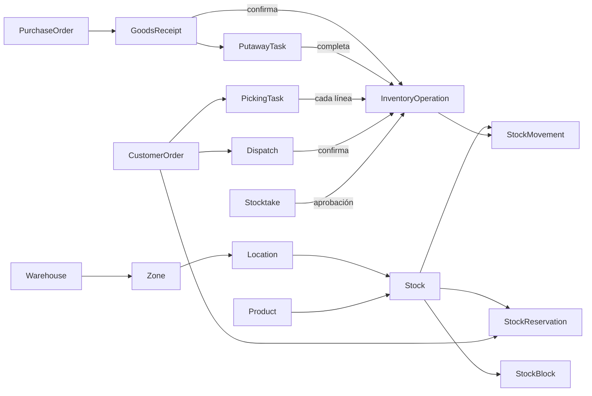
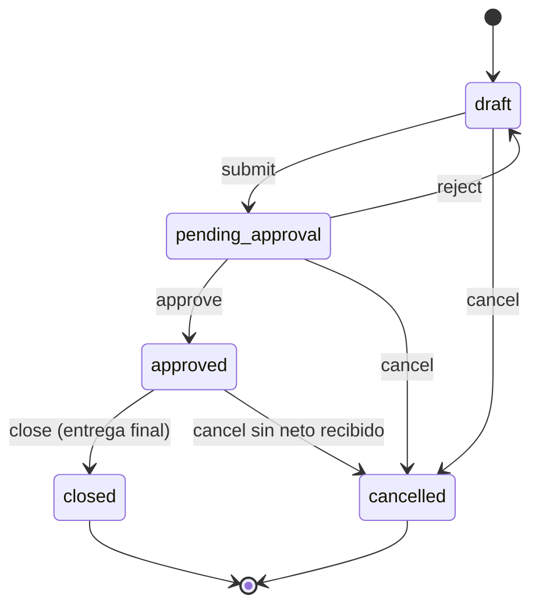
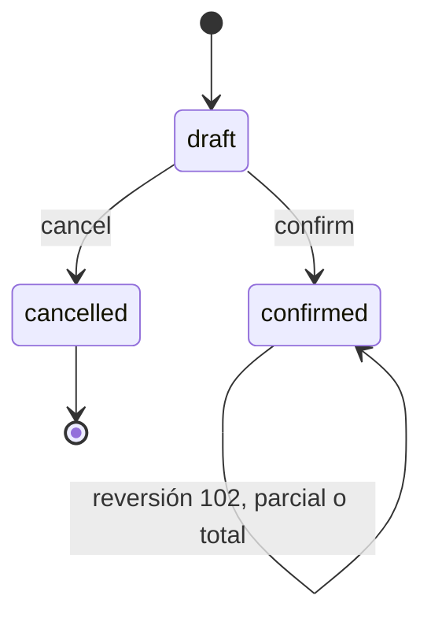
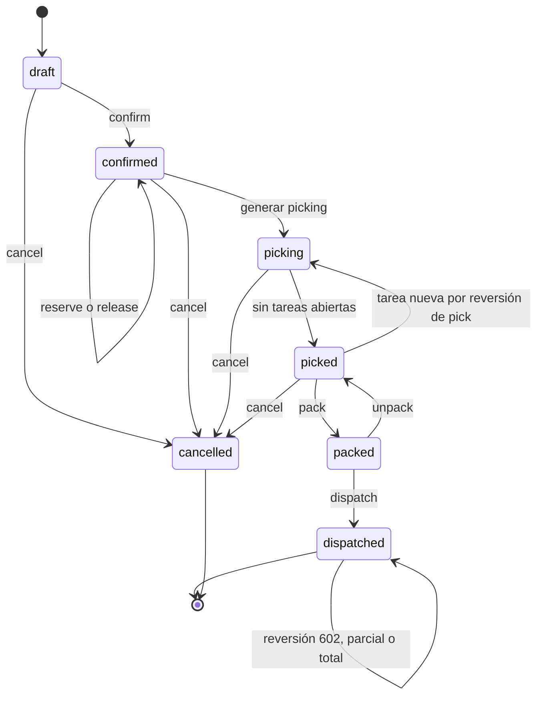
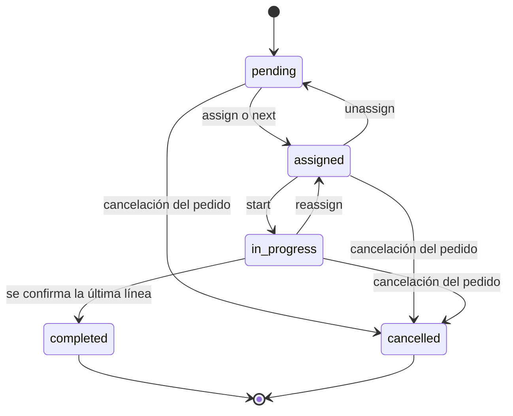
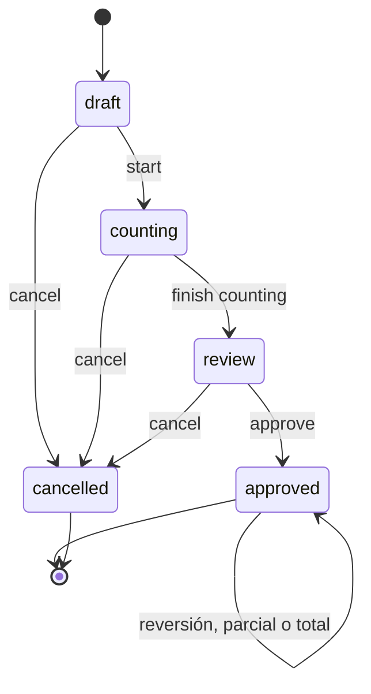

# Modelo de dominio

Entidades por módulo, relaciones principales y máquinas de estado de los documentos. Los nombres siguen el [glosario](../01-business/glossary.md); las reglas citadas están en [business-rules.md](../02-analysis/business-rules.md); el esquema físico está en [database-design.md](database-design.md).

## Convenciones

| Concepto | Criterio |
| - | - |
| Transición | Cambio de estado de un documento ejecutado por una Action. Toda transición no listada en la tabla de su máquina es inválida y responde 409 `INVALID_STATE_TRANSITION` |
| Permiso | Permiso de `spatie/laravel-permission` con nomenclatura `modulo.accion`, verificado por la Policy junto con el alcance por depósito: consulta en los depósitos asignados o en todos con `warehouses.view_all`, operación en los asignados o en todos con `warehouses.operate_all` (REG-005, [ADR-009](adr/009-spa-authentication-authorization.md)) |
| Sistema | Transición que no se invoca directamente: es efecto de otra transición y ocurre en la misma transacción, con el permiso de la transición que la provoca |
| Bloqueo de cabecera | Toda transición bloquea la fila del documento con `SELECT ... FOR UPDATE` y valida el estado después de obtener el bloqueo. Esto serializa transiciones concurrentes sobre el mismo documento |
| Estado final | Estado sin transiciones de salida. Un documento en estado final no se edita |
| Auditoría | Toda transición escribe un registro en `audit_logs` dentro de la misma transacción (INV-012) |
| Reversión | Operación `reversal` que anula, en todo o en parte, el efecto sobre el stock de un documento confirmado, con los códigos de reversión (DM-04, DM-15). Se aplica por posición y por cantidad, puede repetirse hasta agotar lo original y exige motivo y un permiso `*.reverse` propio |
| Clave de ayuda | Cada estado, código de movimiento, tipo de tarea y código de error tiene una clave estable que la interfaz usa para enlazar a su explicación en la wiki (DM-11) |

## Principios: movimientos, tareas y estados (DM-18)

El modelo separa tres capas, como SAP (MM-IM, WM/EWM y SD/MM); la decisión y sus alternativas están en [ADR-015](adr/015-movements-tasks-states.md):

| Capa | Qué registra | Ejemplos | Cómo se corrige |
| - | - | - | - |
| Movimientos | La verdad del stock: qué cantidad entró o salió, de dónde, quién y cuándo. Inmutable | Operaciones y movimientos 101, 911, 601 | Con otro movimiento (102, 912, 602), por posición y por cantidad |
| Tareas físicas | El trabajo que alguien tiene que hacer en el depósito | Solicitud de guardado, tarea de picking | Se ejecutan, se revierten en parte o se confirman con diferencia |
| Estados del proceso | En qué paso está un documento y qué acción se permite a continuación | Borrador, aprobado, empacado | Solo con las transiciones de su máquina |

Reglas:

1. El libro de movimientos es la verdad del stock. Toda corrección es otro movimiento, parcial por posición (DM-15).
2. Los estados solo describen el paso del proceso y deciden qué acción se permite a continuación.
3. Una reversión nunca es una transición de estado: cambia cantidades. El documento original muestra original, revertido y neto.
4. Lo que se puede calcular a partir de cantidades se calcula, no se guarda como un estado aparte: lo recibido de una orden de compra, lo reservado o lo faltante de un pedido.
5. El sistema no inventa estados conceptuales: no cancela por su cuenta un documento porque sus cantidades quedaron en cero. Cancelar es una decisión de un usuario, con motivo.

## Módulos y entidades

Organización según [ADR-001](adr/001-modular-monolith.md). Solo `Inventory` escribe en `stocks`, `stock_movements`, `stock_reservations` y `stock_blocks`; los demás módulos invocan sus Actions.

| Módulo | Entidad | Tabla | Rol |
| - | - | - | - |
| Identity | `User` | `users` | Usuario; se desactiva, nunca se borra |
| | `Role`, `Permission` | tablas de `spatie/laravel-permission` | Roles y permisos |
| Warehouse | `Warehouse` | `warehouses` | Raíz del alcance de seguridad |
| | `Zone` | `zones` | Agrupación funcional de ubicaciones |
| | `Location` | `locations` | Lugar físico con estado propio (ver máquina de estados) |
| | asignación usuario depósito | `user_warehouse` | Alcance de seguridad (REG-005) |
| Catalog | `Category` | `categories` | Jerarquía de productos |
| | `UnitOfMeasure` | `units_of_measure` | Unidad base ([ADR-005](adr/005-integer-quantities.md)) |
| | `Product` | `products` | Artículo maestro |
| | `Supplier` | `suppliers`, `product_supplier` | Proveedor y su código de producto |
| | `Customer` | `customers` | Destinatario de pedidos |
| Inventory | `Stock` | `stocks` | Proyección por producto, ubicación y lote |
| | `InventoryOperation` | `inventory_operations` | Hecho de negocio confirmado, inmutable |
| | `StockMovement` | `stock_movements` | Línea de operación con delta firmado, inmutable |
| | `StockReservation` | `stock_reservations` | Compromiso de stock para una línea de pedido |
| | `StockBlock` | `stock_blocks` | Inmovilización de una cantidad sin moverla |
| | `MovementType` | `movement_types` | Catálogo de códigos de movimiento con su reversión (DM-09) |
| | `IdempotencyKey` | `idempotency_keys` | Registro de peticiones idempotentes ([ADR-007](adr/007-idempotency.md)) |
| Procurement | `PurchaseOrder` | `purchase_orders`, `purchase_order_items` | Orden de compra y sus líneas |
| Receiving | `GoodsReceipt` | `goods_receipts`, `goods_receipt_items` | Recepción y sus líneas |
| | `PutawayTask` | `putaway_tasks` | Traslado pendiente a almacenamiento |
| Fulfillment | `CustomerOrder` | `customer_orders`, `customer_order_items` | Pedido y sus líneas |
| | `PickingTask` | `picking_tasks`, `picking_task_lines` | Tarea de picking y sus líneas |
| | `Package` | `packages`, `package_items` | Bulto y su contenido |
| | `Dispatch` | `dispatches` | Salida de mercadería de un pedido; documento propio y reversible (DM-10) |
| Stocktaking | `Stocktake` | `stocktakes`, `stocktake_locations`, `stocktake_items` | Inventario físico, alcance y conteos |
| Audit | `AuditLog` | `audit_logs` | Registro inmutable de auditoría |

## Relaciones principales

| Relación | Cardinalidad | Nota |
| - | - | - |
| Documento a operación | Un documento origina como máximo una operación de inventario por instancia (recepción, tarea de putaway, línea de picking, despacho, inventario físico), más sus reversiones | Garantizado en base de datos por la unicidad de la referencia de la operación (ver [database-design.md](database-design.md#e3-núcleo-transaccional-de-inventario)) |
| Operación a movimientos | Una operación tiene uno o más movimientos, cada uno con su código (DM-09) | Una transferencia tiene dos (931 salida y entrada); un despacho, uno por fila de stock de PACKING (601) |
| Operación a reversión | Una operación admite varias reversiones parciales, vinculadas por `reverses_operation_id`; cada línea de reversión apunta a la línea original que revierte | La base impide revertir más que la cantidad original de cada línea (trigger `stock_movements_validate_reversal`, DM-15) |
| Línea de pedido a reservas | Una línea de pedido tiene cero o más reservas | Una por fila de stock asignada, más una sobre PACKING por cada pick confirmado |
| Reserva a línea de picking | Una reserva de almacenamiento genera exactamente una línea de picking | |

## Máquinas de estado de los documentos

### PurchaseOrder

| Estado | Significado | Final |
| - | - | - |
| `draft` | En edición; único estado editable (REG-002) | No |
| `pending_approval` | Enviada a aprobación | No |
| `approved` | Aprobada; admite recepciones. Lo recibido se calcula por línea (ver abajo) | No |
| `closed` | Entrega final marcada por un supervisor: no se esperan más recepciones aunque quede saldo. Equivale al indicador de entrega final de SAP. Una reversión de recepción reduce lo recibido sin reabrirla | Sí |
| `cancelled` | Anulada por un usuario, con motivo, sin neto recibido | Sí |

Estado de recepción, calculado a partir de las líneas y no guardado como estado (DM-18): **sin recibir** si toda línea tiene `quantity_received = 0`, **total** si toda línea tiene `quantity_received >= quantity_ordered` y **parcial** en otro caso. `quantity_received` es lo recibido neto: suma las recepciones confirmadas y resta sus reversiones 102. Recibir o revertir no cambia el estado de la orden.

| Desde | Hacia | Disparador | Permiso | Condiciones y reglas | Efectos |
| - | - | - | - | - | - |
| `draft` | `pending_approval` | `POST /purchase-orders/{id}/submit` | `procurement.create` | Al menos una línea | |
| `pending_approval` | `approved` | `POST /purchase-orders/{id}/approve` | `procurement.approve` | El aprobador no es el creador (REG-001, 403 `SELF_APPROVAL_NOT_ALLOWED`) | Registra `approved_by`, `approved_at`. No modifica stock (REG-003) |
| `pending_approval` | `draft` | `POST /purchase-orders/{id}/reject` | `procurement.approve` | Motivo obligatorio | Vuelve a ser editable |
| `approved` | `closed` | `POST /purchase-orders/{id}/close` | `procurement.close` | Motivo obligatorio. Alguna línea con neto recibido mayor que cero; sin nada recibido la orden se cancela | Cancela las recepciones en `draft` de la orden. Ya no admite recepciones nuevas |
| `draft`, `pending_approval`, `approved` | `cancelled` | `POST /purchase-orders/{id}/cancel` | `procurement.cancel` | Neto recibido cero en todas las líneas (409 `INVALID_STATE_TRANSITION` si no). Motivo obligatorio | Cancela las recepciones en `draft` de la orden |

### GoodsReceipt

| Estado | Significado | Final |
| - | - | - |
| `draft` | Carga en curso; se guarda parcialmente sin afectar stock | No |
| `confirmed` | Mercadería ingresada al stock de la ubicación de recepción (101) | No |
| `cancelled` | Descartada sin efecto sobre el stock | Sí |

| Desde | Hacia | Disparador | Permiso | Condiciones y reglas | Efectos |
| - | - | - | - | - | - |
| (nuevo) | `draft` | `POST /goods-receipts` | `receiving.create`; además `receiving.blind` si no tiene orden | Con orden: la orden está en `approved` | |
| `draft` | `confirmed` | `POST /goods-receipts/{id}/confirm` (idempotente) | `receiving.confirm`; además `receiving.over_receive` si excede la tolerancia | Bloqueo de la orden y de sus líneas en orden de `id` (INV-006, 422 `OVER_RECEIPT_NOT_ALLOWED`). La orden está en `approved`. Rechazos con motivo (REG-004). Al menos una línea con cantidad | Operación `receipt` sobre la ubicación de recepción por lo aceptado (si es mayor que cero). Actualiza `quantity_received` de las líneas de la orden; su estado no cambia. Crea una `PutawayTask` por línea aceptada. Repetida: 409 `OPERATION_ALREADY_CONFIRMED` (INV-007) |
| `draft` | `cancelled` | `POST /goods-receipts/{id}/cancel` o sistema (cancelación o cierre de la orden) | `receiving.cancel` | | |
| `confirmed` | `confirmed` | `POST /goods-receipts/{id}/reverse` (idempotente), con las posiciones y cantidades a revertir; sin posiciones revierte el saldo de todas | `receiving.reverse` | Motivo obligatorio. La recepción tiene operación. Por posición, la cantidad no supera lo aceptado menos lo ya revertido (422 `REVERSAL_EXCEEDS_REMAINING`). Lo revertido está libre en la ubicación de recepción: lo comprometido por una solicitud de guardado pendiente exige revertir antes la solicitud y lo ya guardado exige revertir antes el guardado (409 `DEPENDENT_DOCUMENTS_NOT_REVERSED`) | Operación `reversal` con 102 por las posiciones elegidas. Suma a `quantity_reversed` de cada posición, resta lo mismo de `quantity_received` de la línea de la orden. La recepción no cambia de estado: muestra por posición lo aceptado, lo revertido y el neto |

La devolución a proveedor (122 en SAP) está fuera del alcance inicial.

### CustomerOrder

| Estado | Significado | Final |
| - | - | - |
| `draft` | En edición; único estado editable | No |
| `confirmed` | Aceptado. Se reserva y se libera sin cambiar de estado; lo reservado se calcula por línea (ver abajo) | No |
| `picking` | Al menos una tarea de picking abierta | No |
| `picked` | Sin tareas de picking abiertas; lo pickeado está en PACKING, reservado para el pedido. Lo pickeado puede ser cero si todo fue faltante: el pedido no se cancela solo, el responsable decide (DM-03) | No |
| `packed` | Lo pickeado está embalado en bultos y verificado | No |
| `dispatched` | Mercadería despachada, con su despacho. Una reversión no cambia el estado: el pedido muestra despachado, revertido y neto | Sí |
| `cancelled` | Anulado por un usuario, con motivo; reservas liberadas. Equivale al motivo de rechazo de SAP | Sí |

Cantidades por línea, calculadas y no guardadas como estado (DM-18): **reservado** (`quantity_reserved`: sin reservar, parcial o total respecto de lo pedido), **pickeado** (`quantity_picked`), **faltante** (`quantity_short`) y, una vez despachado, **despachado, revertido y neto** a partir de los movimientos 601 y 602 del despacho.

| Desde | Hacia | Disparador | Permiso | Condiciones y reglas | Efectos |
| - | - | - | - | - | - |
| `draft` | `confirmed` | `POST /orders/{id}/confirm` | `orders.create` | Al menos una línea | |
| `confirmed` | `confirmed` | `POST /orders/{id}/reserve` | `orders.reserve` | Asignación FIFO por `last_movement_at` sobre ubicaciones `active` de zonas `storage` y `picking`. Con `allow_partial = false` reserva todo o nada (422 `INSUFFICIENT_STOCK`). Sin disponible alguno, 422 `INSUFFICIENT_STOCK`. Dos pedidos concurrentes no reservan más que el disponible (INV-005) | Crea reservas y actualiza `quantity_reserved` de stock y de las líneas. El estado no cambia |
| `confirmed` | `confirmed` | `POST /orders/{id}/release` | `orders.reserve` | Sin tarea de picking (implícito en el estado). Motivo opcional | Libera todas las reservas activas del pedido y pone en cero `quantity_reserved` de sus líneas (DM-12) |
| `confirmed` | `picking` | `POST /orders/{id}/picking-tasks` | `picking.manage` | Alguna línea con `quantity_reserved` mayor que cero. Sin otra tarea abierta para el pedido | Crea la `PickingTask` con una línea por reserva, ordenadas por código de ubicación. Lo no reservado queda sin atender |
| `picking` | `picked` | Sistema: se completa la última tarea abierta del pedido | `picking.execute` | | Lo pickeado puede ser cero (faltante total); el pedido no se cancela solo (DM-03) |
| `picked` | `picking` | Sistema: reversión de una línea de picking | `picking.reverse` | | El sistema genera una tarea de picking nueva por lo revertido (DM-18) |
| `picked` | `picked` | `POST /orders/{id}/items/{itemId}/packing-damage` (idempotente) | `inventory.adjust`; además `inventory.adjust.approve` sobre el umbral de INV-008 | Cantidad mayor que cero y no mayor que `quantity_picked` de la línea. PACKING `active` (INV-009). Con el pedido en `packed` se desempaca primero | Operación `adjustment_out` con motivo `damage` y 551 en PACKING que consume la reserva de la línea en PACKING; si la reserva era mayor, se crea una reserva nueva por el resto. Pasa la cantidad de `quantity_picked` a `quantity_short`. El pedido no cambia de estado aunque no quede nada pickeado (DM-13) |
| `picked` | `packed` | `POST /orders/{id}/pack` | `packing.execute` | Lo pickeado del pedido es mayor que cero. Por línea, lo empaquetado es igual a lo pickeado (INV-011) | |
| `packed` | `dispatched` | `POST /orders/{id}/dispatch` (idempotente) | `dispatch.execute` | Estado `packed` (INV-011, 409 `ORDER_NOT_READY_FOR_DISPATCH`) | Crea el `Dispatch` (`DS`) y su operación `dispatch` con 601 en PACKING, que consume las reservas. Repetido: 409 `OPERATION_ALREADY_CONFIRMED` (INV-007) |
| `packed` | `picked` | `POST /orders/{id}/unpack` | `packing.reverse` | Sin despacho | Los bultos vuelven a ser editables. No mueve stock |
| `dispatched` | `dispatched` | `POST /dispatches/{id}/reverse` (idempotente), con los productos y cantidades a revertir; sin posiciones revierte todo | `dispatch.reverse` | Motivo obligatorio. Por producto, la cantidad no supera lo despachado menos lo ya revertido (422 `REVERSAL_EXCEEDS_REMAINING`). PACKING `active` | Operación `reversal` con 602 en PACKING: lo revertido vuelve como stock libre y se crea una solicitud de guardado de retorno. Ni el despacho ni el pedido cambian de estado; muestran por producto despachado, revertido y neto (DM-17) |
| `draft`, `confirmed`, `picking`, `picked` | `cancelled` | `POST /orders/{id}/cancel` | `orders.cancel` | No desde `packed` ni posterior (REG-009). Motivo obligatorio | Libera todas las reservas activas. Cancela la tarea de picking abierta. Si hay mercadería en PACKING crea una `PutawayTask` de retorno a almacenamiento |

### PickingTask

| Estado | Significado | Final |
| - | - | - |
| `pending` | Sin operador asignado | No |
| `assigned` | Asignada a un operador, sin iniciar | No |
| `in_progress` | En ejecución por el operador asignado | No |
| `completed` | Todas las líneas confirmadas. Muestra por línea a pickear, pickeado, faltante, revertido y neto. Una reversión no la reabre: lo revertido se pickea en una tarea nueva, como una nueva orden de almacén en SAP EWM | Sí |
| `cancelled` | Anulada por cancelación del pedido | Sí |

| Desde | Hacia | Disparador | Permiso | Condiciones y reglas | Efectos |
| - | - | - | - | - | - |
| `pending` | `assigned` | `POST /picking-tasks/{id}/assign` | `picking.manage` | El operador tiene acceso al depósito | |
| `pending` | `assigned` | `GET /picking-tasks/next` | `picking.execute` | Toma la más antigua por prioridad del pedido; se asigna al solicitante con `FOR UPDATE SKIP LOCKED` | |
| `assigned` | `pending` | `POST /picking-tasks/{id}/unassign` | `picking.manage` | | |
| `assigned` | `in_progress` | `POST /picking-tasks/{id}/start` | `picking.execute` | Solo el operador asignado. Sin otra tarea `in_progress` del mismo operador (REG-007, 409 `PICKING_TASK_IN_PROGRESS`) | Registra `started_at` |
| `in_progress` | `assigned` | `POST /picking-tasks/{id}/assign` | `picking.manage` | Reasignación a otro operador; conserva las líneas confirmadas | |
| `in_progress` | `completed` | Sistema: se confirma la última línea | `picking.execute` | | Si el pedido no tiene otra tarea abierta, pasa a `picked` |
| `pending`, `assigned`, `in_progress` | `cancelled` | Sistema: cancelación del pedido | `orders.cancel` | | Las líneas `pending` no generan operación; sus reservas se liberan |

Líneas de picking. El faltante no es un estado: es la cantidad `quantity_to_pick - quantity_picked` de una línea confirmada.

| Desde | Hacia | Disparador | Permiso | Condiciones y reglas | Efectos |
| - | - | - | - | - | - |
| `pending` | `confirmed` | `POST /picking-tasks/{id}/lines/{lineId}/pick` (idempotente) | `picking.execute` | Tarea `in_progress` del solicitante. Escaneo de ubicación y producto esperados (REG-008, 422 `SCAN_MISMATCH`). Cantidad igual a `quantity_to_pick` | Operación `pick` (921) de la ubicación de almacenamiento a PACKING; consume la reserva y crea una reserva sobre la fila de PACKING para la misma línea de pedido |
| `pending` | `confirmed` | `POST /picking-tasks/{id}/lines/{lineId}/short` (idempotente) | `picking.execute` | Mismas validaciones de escaneo. Cantidad encontrada menor que `quantity_to_pick`, posiblemente cero | Si lo encontrado es mayor que cero, operación `pick` por esa cantidad. Libera el resto de la reserva, incrementa `quantity_short` de la línea de pedido y marca la ubicación para conteo cíclico. La línea muestra a pickear, pickeado y faltante |
| `confirmed` | `confirmed` | `POST /picking-tasks/{id}/lines/{lineId}/reverse` (idempotente), con la cantidad a revertir; sin cantidad revierte el saldo | `picking.reverse` | Motivo obligatorio. La línea tiene operación. La cantidad no supera lo pickeado menos lo ya revertido (422 `REVERSAL_EXCEEDS_REMAINING`). El pedido no está en `packed` ni posterior (409 `DEPENDENT_DOCUMENTS_NOT_REVERSED`). La ubicación de origen está `active` (INV-009) | Operación `reversal` con 922 de PACKING a la ubicación de origen por la cantidad. Reemplaza la reserva de PACKING por una por el saldo y crea una reserva en origen por lo revertido. Agrega una línea `pending` por lo revertido en una tarea nueva del pedido, o en su tarea abierta si ya tiene una; pasa esa cantidad de `quantity_picked` a `quantity_reserved`. La línea y su tarea no cambian de estado: muestran pickeado, revertido y neto. Lo faltante no se restituye |

### Stocktake

| Estado | Significado | Final |
| - | - | - |
| `draft` | Alcance en definición (zonas o ubicaciones); sin efecto sobre las ubicaciones | No |
| `counting` | Ubicaciones en estado `counting`, cantidades de sistema fotografiadas, conteo en curso | No |
| `review` | Conteo cerrado; diferencias calculadas; se registran reconteos | No |
| `approved` | Ajustes generados (701 y 702) y ubicaciones liberadas. Una reversión no cambia el estado: el inventario muestra por línea lo ajustado, lo revertido y el neto | Sí |
| `cancelled` | Anulado; ubicaciones liberadas sin ajustes | Sí |

| Desde | Hacia | Disparador | Permiso | Condiciones y reglas | Efectos |
| - | - | - | - | - | - |
| (nuevo) | `draft` | `POST /stocktakes` o sistema (faltante de picking, E6.07) | `stocktake.manage` | Al menos una ubicación | Copia el umbral de reconteo vigente al documento |
| `draft` | `counting` | `POST /stocktakes/{id}/start` | `stocktake.manage` | Bloquea las ubicaciones con `FOR UPDATE` en orden de `id`. Todas en `active` (422 `LOCATION_BLOCKED`) y en ningún otro inventario abierto (REG-006, 409 `LOCATION_ALREADY_IN_STOCKTAKE`). Sin reservas activas, salvo confirmación explícita (409 `LOCATION_HAS_ACTIVE_RESERVATIONS`) | Ubicaciones a `counting`. Una línea por existencia con stock físico mayor que cero, con `system_quantity` |
| `counting` | `review` | `POST /stocktakes/{id}/finish-counting` | `stocktake.manage` | Todas las líneas contadas | Calcula diferencias y marca `recount_required` donde la diferencia supera el umbral |
| `review` | `approved` | `POST /stocktakes/{id}/approve` (idempotente) | `stocktake.approve` | El aprobador no contó ni recontó ninguna línea (INV-010, 403 `SELF_APPROVAL_NOT_ALLOWED`). Toda línea con `recount_required` tiene reconteo (REG-011, 409 `RECOUNT_REQUIRED`). El ajuste no deja reservado más bloqueado por encima del físico (INV-001) | Ubicaciones a `active`. Una operación `stocktake_adjustment` con una línea por diferencia distinta de cero (ninguna si no hay diferencias) |
| `draft`, `counting`, `review` | `cancelled` | `POST /stocktakes/{id}/cancel` | `stocktake.manage` | Motivo obligatorio | Ubicaciones a `active` sin ajustes |
| `approved` | `approved` | `POST /stocktakes/{id}/reverse` (idempotente), con las líneas y cantidades a revertir; sin líneas revierte el saldo de todas | `stocktake.reverse` | Motivo obligatorio. El inventario tiene operación. Por línea, la cantidad no supera la diferencia ajustada menos lo ya revertido (422 `REVERSAL_EXCEEDS_REMAINING`). Ubicaciones `active` y en ningún inventario abierto. La reversión no deja stock negativo ni por debajo de lo comprometido (INV-001, 422 `INSUFFICIENT_STOCK`) | Operación `reversal` con 702 por cada 701 y 701 por cada 702, por las cantidades elegidas. Suma a `quantity_reversed` de cada línea. Marca las ubicaciones revertidas para conteo cíclico. |

Registro de conteos, válido solo en los estados indicados:

| Acción | Estado | Permiso | Regla |
| - | - | - | - |
| Registrar conteo de una línea | `counting` | `stocktake.count` | Conteo ciego: la API no expone `system_quantity` a quien cuenta (`is_blind`). Un producto no registrado se agrega como línea con `system_quantity = 0` |
| Registrar reconteo | `review` | `stocktake.count` | Solo en líneas con `recount_required`; quien recuenta es distinto de quien contó (REG-011) |

La cantidad final de una línea es `recount_quantity` si existe y `counted_quantity` en otro caso. La diferencia es la cantidad final menos `system_quantity`.

## Máquinas de estado auxiliares

### Location

| Desde | Hacia | Disparador | Permiso | Condiciones y reglas |
| - | - | - | - | - |
| `active` | `blocked` | `POST /locations/{id}/block` | `locations.block` | Motivo obligatorio. Auditado (INV-012) |
| `blocked` | `active` | `POST /locations/{id}/unblock` | `locations.block` | Auditado |
| `active` | `counting` | Sistema: inicio de inventario físico | `stocktake.manage` | |
| `counting` | `active` | Sistema: aprobación o cancelación del inventario físico | `stocktake.approve` o `stocktake.manage` | |
| `active` | `inactive` | `PATCH /locations/{id}` | `locations.manage` | Sin stock físico (se valida desde E3, con la tabla `stocks`). No aplica a ubicaciones de sistema (422 de validación). Desde `blocked` o `counting`, 409 `INVALID_STATE_TRANSITION` |
| `inactive` | `active` | `PATCH /locations/{id}` | `locations.manage` | |

Solo `active` admite movimientos (INV-009). `blocked` y `counting` no se encadenan: no se bloquea una ubicación en conteo ni se cuenta una bloqueada.

### StockReservation, StockBlock y PutawayTask

| Entidad | Desde | Hacia | Disparador |
| - | - | - | - |
| `StockReservation` | `active` | `consumed` | Pick (reserva de almacenamiento) o despacho (reserva de PACKING); registra la cantidad consumida y la operación |
| | `active` | `consumed` | Baja por daño en PACKING: la operación 551 consume la reserva de PACKING de la línea (DM-13) |
| | `active` | `released` | Cancelación del pedido, faltante de picking o liberación manual con `POST /orders/{id}/release` (`orders.reserve`, DM-12) |
| `StockBlock` | `active` | `released` | `POST /inventory/blocks/{id}/release` con `inventory.block` |
| `PutawayTask` | (nueva) | `pending` | Sistema: confirmación de recepción, cancelación de pedido o reversión de despacho. Crea una reserva sobre el origen por la cantidad: esa mercadería no se ajusta ni se transfiere mientras la solicitud la espera (DM-16) |
| | `pending` | `pending` o `completed` | `POST /putaway-tasks/{id}/reverse` (idempotente) con `putaway.reverse`, cantidad y motivo, por quien la ejecuta o por un supervisor: reduce lo que queda por guardar, sin movimiento de stock porque la mercadería no salió del origen. Reemplaza la reserva por una por el saldo. Queda registrada con usuario, hora y motivo. Si se revierte todo, la solicitud pasa a `completed` con guardado 0, como una orden de transporte confirmada con diferencia en SAP WM |
| | `pending` | `completed` | `POST /putaway-tasks/{id}/complete` (idempotente) con `putaway.execute`: una operación `putaway` (911) por `quantity - quantity_returned` desde el origen hacia una o más ubicaciones de almacenamiento, con validación de `max_units` (REG-010). Consume la reserva |
| | `completed` | `completed` | `POST /putaway-tasks/{id}/reverse` (idempotente) con `putaway.reverse`, destinos, cantidades y motivo: operación `reversal` con 912 de los destinos al origen, si lo revertido está libre en cada destino (INV-001) y el origen está `active`. La mercadería devuelta queda libre en el origen. La solicitud muestra lo guardado, lo revertido y el neto |

## Reversiones

Modelo tomado de SAP (DM-04, DM-15, [ADR-013](adr/013-partial-reversal-by-line.md)): cada documento se revierte desde su propio endpoint, por posición y por cantidad, como un 102 o un 282 sobre una posición de su documento original. La reversión es una operación nueva con los códigos de reversión de [movement_types](database-design.md#e3-núcleo-transaccional-de-inventario), con su usuario, su fecha y su motivo, y el documento acumula lo revertido por posición. Revertir un documento completo es revertir todas sus posiciones por su saldo.

Ejemplo: una recepción con 101 × 50 de un producto admite un 102 × 10 sobre esa posición. La recepción queda con un neto de 40, la orden de compra con 40 recibidas y el historial muestra las dos operaciones. Más adelante se puede revertir el saldo de 40; nada obliga a cancelar y volver a cargar.

| Regla | Detalle |
| - | - |
| Desde el documento | Ninguna operación de un documento se revierte desde el libro; `POST /inventory/operations/{id}/reverse` responde 409 `OPERATION_NOT_REVERSIBLE` para ellas |
| Estado del documento | La reversión es otro documento, como una anulación en SAP: el documento original no cambia de estado. Muestra por posición el original, lo revertido y el neto (despachado 10, revertido 10, neto 0). Solo los estados derivados de cantidades se recalculan, como el de la orden de compra según lo recibido |
| Parcial y repetible | Cada reversión elige posiciones y cantidades. Una posición se revierte tantas veces como haga falta mientras quede saldo; superarlo responde 422 `REVERSAL_EXCEEDS_REMAINING`, garantizado en la base |
| Posición | La unidad que se revierte: la línea de una recepción, el destino de un guardado, la línea de picking, el producto de un despacho, la línea de un inventario físico, la transferencia (su salida y su entrada juntas, por la misma cantidad) o la línea de un ajuste |
| Orden inverso de la cadena, por cantidad | Se revierte primero el último paso, pero solo por la cantidad afectada: de una recepción de 50 con 30 ya guardadas, las 20 que siguen libres en RECEPCION se revierten directamente; para revertir más, primero se revierte parte del guardado (409 `DEPENDENT_DOCUMENTS_NOT_REVERSED`) |
| Sin stock negativo | La reversión valida INV-001 como cualquier movimiento; si la mercadería ya se usó, se rechaza |
| Baja por daño en PACKING | Se revierte desde el libro porque es un ajuste, pero corrige el pedido: con el pedido en `picked` recrea la reserva en PACKING y devuelve la cantidad de `quantity_short` a `quantity_picked`; con el pedido `cancelled` deja la mercadería libre en PACKING y crea una solicitud de guardado de retorno; con el pedido en `packed` o `dispatched` responde 409 `DEPENDENT_DOCUMENTS_NOT_REVERSED` (DM-13) |
| Usuario, motivo y permiso | Toda reversión registra quién la hizo (`performed_by`), cuándo y por qué (motivo obligatorio), exige el permiso `*.reverse` del módulo y queda auditada (INV-012) |

| Documento | Endpoint | Códigos | Equivalente SAP |
| - | - | - | - |
| Transferencia, ajuste | `POST /inventory/operations/{id}/reverse` | 932, 552, 562, 711, 712 | 312 o anulación con MBST, por posición |
| Baja por daño en PACKING | `POST /inventory/operations/{id}/reverse` | 552 | Anulación con MBST |
| Recepción | `POST /goods-receipts/{id}/reverse` | 102 | 102 desde MIGO con referencia al documento, por posición y cantidad |
| Solicitud de guardado pendiente | `POST /putaway-tasks/{id}/reverse` | Sin movimiento | Confirmación de la tarea de almacén con diferencia |
| Solicitud de guardado completada | `POST /putaway-tasks/{id}/reverse` | 912 | Tarea de almacén de vuelta al origen |
| Línea de picking | `POST /picking-tasks/{id}/lines/{lineId}/reverse` | 922 | Anulación de cantidad pickeada |
| Empaque | `POST /orders/{id}/unpack` | Sin movimiento | Anulación de embalaje |
| Despacho | `POST /dispatches/{id}/reverse` | 602 | Devolución parcial o anulación de la salida de mercancías |
| Inventario físico | `POST /stocktakes/{id}/reverse` | 701 y 702 invertidos | Anulación de diferencias con MBST, por posición |

## Catálogo de permisos

Permisos que exigen las transiciones de este documento y la administración de datos maestros, con nomenclatura `modulo.accion`. El código los define en `App\Modules\Identity\Authorization\Permission` y el comando `wms:sync-authorization` los lleva a la base en cada entorno (E2.07); un permiso nuevo se agrega en los dos lugares en el mismo cambio. Las consultas de datos maestros no exigen permiso propio: alcanza con la sesión y el alcance de consulta por depósito (REG-005), salvo usuarios y roles, que exigen `users.manage`. Toda operación sobre un recurso de un depósito exige el permiso de la acción y que el depósito esté asignado al usuario, o `warehouses.operate_all`.

| Permiso | Alcance |
| - | - |
| `warehouses.view_all` | Consulta de todos los depósitos (stock, movimientos, documentos, zonas y ubicaciones) sin tenerlos asignados. Equivale en SAP a la actividad 03 con `WERKS = *` |
| `warehouses.operate_all` | Operación en todos los depósitos sin tenerlos asignados. Equivale en SAP a las actividades 01 y 02 con `WERKS = *` |
| `warehouses.manage` | Alta, edición y desactivación de depósitos |
| `locations.manage` | Alta, edición y desactivación de zonas y ubicaciones |
| `locations.block` | Bloqueo y desbloqueo de ubicaciones |
| `catalog.manage` | Alta y edición de categorías, unidades de medida y productos |
| `suppliers.manage` | Alta y edición de proveedores y de su relación con los productos |
| `inventory.transfer` | Transferencias manuales |
| `inventory.adjust` | Ajustes con motivo |
| `inventory.adjust.approve` | Ajustes negativos por encima del umbral (INV-008) |
| `inventory.block` | Bloqueo y liberación de cantidades de stock |
| `inventory.reverse` | Reversión de transferencias y ajustes |
| `procurement.create` | Crear, editar y enviar órdenes de compra |
| `procurement.approve` | Aprobar y rechazar órdenes de compra |
| `procurement.cancel` | Cancelar órdenes de compra |
| `procurement.close` | Cerrar órdenes con saldo pendiente |
| `receiving.create` | Crear y editar recepciones en `draft` |
| `receiving.blind` | Recepción sin orden de compra |
| `receiving.confirm` | Confirmar recepciones |
| `receiving.cancel` | Cancelar recepciones en `draft` |
| `receiving.over_receive` | Recibir por encima de la tolerancia (INV-006) |
| `receiving.reverse` | Revertir recepciones confirmadas (102) |
| `putaway.execute` | Completar solicitudes de guardado |
| `putaway.reverse` | Revertir solicitudes de guardado, pendientes (sin movimiento) o completadas (912). Lo tienen los roles Operador y Supervisor |
| `orders.create` | Crear, editar y confirmar pedidos |
| `orders.reserve` | Reservar y liberar reservas de pedidos |
| `orders.cancel` | Cancelar pedidos |
| `picking.manage` | Generar, asignar y reasignar tareas de picking |
| `picking.execute` | Tomar, iniciar y resolver líneas de picking |
| `picking.reverse` | Revertir líneas de picking resueltas (922) |
| `packing.execute` | Registrar bultos y cerrar el packing |
| `packing.reverse` | Reabrir el packing de un pedido no despachado |
| `dispatch.execute` | Despachar pedidos |
| `dispatch.reverse` | Revertir despachos (602) |
| `stocktake.manage` | Crear, iniciar, cerrar el conteo y cancelar inventarios físicos |
| `stocktake.count` | Registrar conteos y reconteos |
| `stocktake.approve` | Aprobar inventarios físicos (INV-010) |
| `stocktake.reverse` | Revertir inventarios físicos aprobados |
| `users.manage` | Usuarios, roles y asignación de depósitos |
| `audit.view` | Consulta de auditoría |

### Roles

Los roles son datos del sistema con identificador estable; la interfaz traduce su nombre. Cada rol tiene exactamente estos permisos, definidos en `App\Modules\Identity\Authorization\Role`. La edición de roles desde la interfaz queda fuera del MVP.

| Rol | Identificador | Permisos |
| - | - | - |
| Administrador | `administrator` | Todos, como `SAP_ALL`. Las reglas de segregación por documento (REG-001, INV-010, DM-08) también lo alcanzan |
| Supervisor | `supervisor` | `warehouses.view_all`, `locations.block`, todos los de `inventory`, `procurement.approve`, `procurement.cancel`, `procurement.close`, todos los de `receiving`, `putaway`, `orders`, `picking`, `packing` y `dispatch`, `stocktake.manage`, `stocktake.approve`, `stocktake.reverse` y `audit.view` |
| Operador | `operator` | `warehouses.view_all`, `inventory.transfer`, `receiving.create`, `receiving.confirm`, `putaway.execute`, `putaway.reverse`, `picking.execute`, `packing.execute`, `dispatch.execute` y `stocktake.count` |
| Compras | `purchasing` | `warehouses.view_all`, `suppliers.manage`, `procurement.create` y `procurement.cancel` |
| Auditor | `auditor` | `warehouses.view_all` y `audit.view` |

## Decisiones de modelado

| ID | Decisión | Fundamento |
| - | - | - |
| DM-01 | Rechazar una orden en `pending_approval` la devuelve a `draft` con motivo, sin estado `rejected` | Mantiene la lista de estados de E0 y permite corregir y reenviar; el rechazo queda en la auditoría |
| DM-02 | `closed` es el indicador de entrega final: un supervisor lo marca con motivo cuando no se esperan más recepciones aunque quede saldo. Recibido parcial o total no son estados: se calculan de lo recibido neto por línea | Como en SAP, la orden queda aprobada mientras dure el abastecimiento y lo recibido se lee de los documentos de material; una reversión 102 no mueve el estado de la orden. Una orden sin nada recibido no se cierra: se cancela |
| DM-03 | La política del pedido (`allow_partial`) gobierna solo la reserva. Un faltante en picking siempre deja empacar y despachar lo pickeado. Si no se pickeó nada, el pedido queda en `picked` con pickeado 0 y faltante a la vista; el sistema no lo cancela: el responsable decide cancelarlo con motivo | Los faltantes son una excepción física que no se resuelve con reglas de reserva. Como en SAP, el pedido muestra la cantidad pendiente y la cancelación es una decisión con motivo de rechazo. Los pedidos pendientes de reposición (backorders) están fuera del alcance |
| DM-04 | Toda operación es reversible, como en SAP: las de un documento desde el endpoint de reversión del documento, que corrige su estado y sus cantidades; las transferencias y los ajustes desde el endpoint genérico. Se revierte en orden inverso de la cadena (ver [Reversiones](#reversiones)) | Mantiene el libro y los documentos coherentes (`quantity_received`, `quantity_picked`) y permite corregir cualquier error sin ajustes manuales que oculten su origen. Es el modelo que SAP resolvió con sus pares de movimiento y las anulaciones de MIGO y VL09 |
| DM-05 | La solicitud de guardado es una entidad persistida (`putaway_tasks`), originada por una recepción, por la cancelación de un pedido con mercadería en PACKING o por la reversión de un despacho. Se completa en una sola operación que admite varias ubicaciones destino | Da idempotencia por documento, permite repartir por capacidad (REG-010) y aporta los tiempos para el indicador de recepción a ubicación (E7.08) |
| DM-06 | El retorno a almacenamiento tras cancelar un pedido usa el tipo de operación `putaway`. El tipo `return` del plan de E3 se incorpora junto con el flujo de devoluciones de clientes | Evita un tipo de operación nuevo para un traslado físicamente idéntico al putaway, y no deja en la base un valor admitido que ningún flujo usa |
| DM-07 | La marca de conteo cíclico por faltante se guarda en la ubicación (`cycle_count_requested_at`) y se consume al crear el inventario físico | E5 se cierra antes que E6; la marca no depende de que exista el módulo de inventario físico |
| DM-08 | El aprobador de un inventario físico no puede haber contado ni recontado ninguna línea de ese inventario | Segregación de funciones completa (INV-010) sin depender de quién creó la sesión |
| DM-09 | Cada movimiento lleva un código de movimiento: los de SAP MM-IM donde hay equivalente (101, 102, 551, 561, 601, 602, 701, 702, 711, 712) y el rango 9xx para los internos del depósito (911 guardado, 921 pick, 931 transferencia y sus reversiones). El tipo de operación se conserva | Vocabulario reconocible para usuarios de SAP y reportes por código; en SAP los movimientos internos de WM/EWM son tareas de almacén sin clase de movimiento IM, y el 9xx es el rango de clases propias. El bloqueo de stock (343 y 344 en SAP) no es movimiento en este diseño: no hay tipos de stock |
| DM-10 | El despacho es un documento propio (`dispatches`, prefijo `DS`) en lugar de columnas del pedido | Mantiene una operación por documento (INV-007) y admite reversiones parciales con 602 por producto (DM-17) |
| DM-11 | La interfaz enlaza a la wiki con claves de ayuda estables. Cada estado, código de movimiento, tipo de tarea, permiso y código de error tiene una página o un ancla fija en `wms.maruccimauro.com/docs/referencia/`, por ejemplo `estados#purchase-order-approved`, `movimientos#mov-101` y `errores#insufficient-stock` | El ícono de ayuda junto a un estado o un movimiento abre su explicación. Las anclas explícitas no cambian si cambia el título; una prueba de E8 verifica que toda clave usada por el frontend exista en la wiki compilada |
| DM-12 | La liberación manual de reservas es un único endpoint por pedido, `POST /orders/{id}/release`, que libera todas las reservas activas; el pedido sigue en `confirmed`. No hay liberación por reserva individual | Equivale a anular la asignación del pedido en SAP SD; para reasignar otro stock se libera y se vuelve a reservar |
| DM-13 | La mercadería dañada detectada en PACKING se da de baja allí con 551, en una operación que consume la reserva de PACKING de la línea en la misma transacción; no se revierte el pick. La cantidad pasa a faltante de la línea | Refleja el hecho físico: la mercadería no vuelve al estante. Consumir la reserva en lugar de liberarla y luego ajustar evita una ventana en la que el stock dañado queda libre, y mantiene la distinción de INV-005 entre retiros libres y contra reserva. La trazabilidad al pedido queda en `stock_movements.reservation_id`, sin referencia en la operación, porque una línea puede tener varias bajas |
| DM-14 | Ni una transferencia manual ni un ajuste positivo manual tienen como destino una ubicación de sistema (REG-014); los ajustes negativos sí se admiten, porque registran pérdidas reales sin ingresar mercadería. Un sobrante real en RECEPCION se registra con una recepción sin orden (`receiving.blind`) o con un inventario físico. Desde RECEPCION sí se puede transferir lo que esté libre; lo comprometido por una solicitud de guardado pendiente exige revertir antes esa solicitud (DM-16). Las reversiones no están alcanzadas: una transferencia desde RECEPCION se revierte hacia RECEPCION | RECEPCION y PACKING solo se cargan desde sus documentos (recepción y pick), lo que mantiene la conciliación de las líneas de pedido y de las tareas de guardado e impide esquivar el control de sobrerrecepción (INV-006) con un ajuste `found` en RECEPCION. Equivale a SAP, donde la zona de recepción solo se carga con una entrada de mercancías. Transferir desde RECEPCION cubre la ubicación directa de mercadería urgente sin pasar por la tarea |
| DM-15 | Toda reversión es parcial por posición y por cantidad, como 102 o 282 en SAP: una posición se revierte tantas veces como haga falta hasta agotar su cantidad, y revertir el documento completo es revertir todas sus posiciones por su saldo. Cada reversión registra usuario, fecha y motivo, y no cambia el estado del documento original, que muestra original, revertido y neto | Corrige el error exacto sin cancelar ni volver a cargar documentos, y deja en el historial qué salió y qué volvió. El límite lo garantiza la base con un trigger que serializa las reversiones concurrentes de una línea |
| DM-16 | La solicitud de guardado compromete con una reserva el stock de su origen. Quien la ejecuta o un supervisor la revierte en parte o en total con motivo, antes de guardar (sin movimiento) o después (912). Lo que pase con la mercadería devuelta es un flujo aparte: por ejemplo, el supervisor lee el motivo "roto" y la da de baja con 551 | Separa responsabilidades: el acomodador informa lo que no guardó y por qué, y el supervisor decide el ajuste. La reserva impide que el stock del muelle se ajuste o transfiera mientras una solicitud lo espera, lo que obliga al orden inverso de la cadena |
| DM-17 | Lo revertido de un despacho vuelve a PACKING como stock libre, con una solicitud de guardado de retorno. Ni el despacho ni el pedido cambian de estado: muestran despachado, revertido y neto, también cuando el neto es cero. Un pedido tiene un solo despacho; un reenvío es un pedido nuevo | Es como en SAP: la anulación es otro documento y el original conserva su historia. Evita estados conceptuales como cancelar un pedido que sí se despachó, y varios despachos vigentes por pedido. Reemplaza el flujo anterior de DM-10, en el que una reversión total devolvía el pedido a `packed` para despacharlo de nuevo |
| DM-18 | Tres capas separadas, como en SAP: movimientos (verdad del stock, se corrigen con otro movimiento), tareas físicas (se ejecutan, se revierten o se confirman con diferencia) y estados del proceso (solo el paso del trámite). Una reversión nunca cambia un estado; lo calculable a partir de cantidades no se guarda como estado, y el sistema no cancela documentos por su cuenta. Por eso la orden de compra no tiene estados de recepción, el pedido no tiene estados de reserva, el faltante y lo revertido son cantidades, una reversión de picking genera una tarea nueva y una solicitud de guardado revertida por completo queda `completed` con guardado 0 | Evita estados conceptuales que contradicen las cantidades (un pedido despachado y cancelado a la vez, una orden recibida que vuelve a aprobada) y alinea el modelo con cómo lo resuelve SAP: estados de proceso por documento y estados de cantidades calculados de los documentos de material (ver [Principios](#principios-movimientos-tareas-y-estados-dm-18)) |
| DM-19 | El código de una zona y el de una ubicación no cambian después del alta; se corrigen creando la nueva y desactivando la anterior. Las zonas de sistema no cambian de tipo y no admiten ubicaciones dadas de alta a mano; las ubicaciones de sistema no cambian de zona ni se desactivan. La generación masiva crea las ubicaciones de una plantilla (pasillos por letra, estanterías, niveles y posiciones por número, con código `A-01-01` o `A-01-01-01`) en una sola transacción, todas o ninguna | El código es la clave que llevan las etiquetas y se escanea en la operación (REG-008), como las coordenadas de la ubicación en SAP WM. Las ubicaciones de las zonas de sistema las crea el depósito, como las del área intermedia de SAP (902, 916), que no se dan de alta a mano; así REG-014 se apoya en una sola ubicación de sistema por rol. La plantilla equivale a la generación de ubicaciones con estructura de coordenadas de LS10; un lote parcial obligaría a buscar a mano qué faltó |
